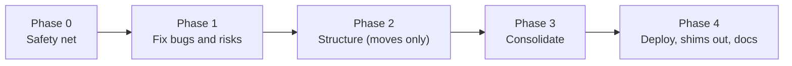

# Athena and Odysseus cleanup: phased plan

As of 2026-10-28. Status (2026-10-29): **in progress**: Phases 0, 1 and 2 merged and gated; Phase 3 running. Covers both repos: Athena (this repo) and
our Odysseus fork (`SDarioosh/odysseus-expanded`, hub side in its
`docs/fork/cleanup-plan.md`, which points here). Each lane is sized for one Claude
subagent, one branch and one PR. An **overseer** session runs the lanes, checks each
one and checks that they work together. Tests run at every step.

## Why

Both repos grew fast: 367 Athena commits and 373 hub commits in October, MCP contract
0.7 → 0.18 in a month, and the Zoom bot added 7 server modules and a C++ bot. Nothing is
broken, but the code shows it:

- Athena: `store.py` (3,259 lines, ~150 methods) and `llm.py` (1,900 lines, ~1,000 of them
  regex rules over model output) hold most of the server. Meeting code calls private
  `Pipeline` methods 8 times, and `pipeline.py` has 17 meeting branches. Schema migrations
  collide (two lanes both wanted version 16, `store.py:604`).
- Hub: 44 fork files sit flat among upstream's `src/`; Athena is reached about 9 different
  ways with 3 error types; 10 copies of `el()` and 6 of `api()` in the frontend; most fork
  settings can't reach the production container.
- Docs: `PROGRESS.md` is 1,768 lines of logs, `server/README.md` 1,361, FORK.md rows run to
  2,800 characters, and the fork file lists in AGENTS.md and FORK.md disagree.

The review behind this plan (findings with file and line references) is summarized in each
lane below.

## Ground rules for every lane

1. **No contract change.** No MCP tool name, argument, annotation, link format, auth, relay
   path, JSON field or stored identifier changes in this plan. The MCP version stays at
   0.20.0. A lane that finds it needs one stops and writes `ESCALATE:`; the owner decides
   and it becomes its own coordinated PR pair per the versioning rules.
2. **No behaviour change unless the lane says so.** Lanes marked *behaviour* change
   output on purpose (bug fixes) and say exactly what changes. Every other lane is a
   refactor: same answers, same stored data, same API bytes.
3. **Protected names stay unless a rename lane changes them** (AGENTS.md "Names" in both
   repos): `convo_server`, `CONVO_*`, `convo.db`, server name `convo`, `odysseus-sound`
   stored values, `barvis_*` action ids and state files, `BARVIS_SOUND_*`. Only the lanes
   marked *rename* (see "Renaming to Athena") change an old name, each following
   `docs/athena-rename-plan.md`: the old name keeps working, no data migration except 4F,
   and the "don't rename" lists in both AGENTS.md files are updated in the same PR. The
   hidden IDs listed under "Renaming to Athena" never change. Moves keep the old import paths working
   until the cleanup lane of that phase removes them.
4. **Old names keep working.** A setting or module that moves keeps its old name readable
   (env alias or a re-export shim) until Phase 4.
5. **Fictional data only** (`server/scripts/seed_demo.py`). No real recordings, transcripts
   or tokens in fixtures, snapshots, PRs or logs.
6. **Hub fork rules apply** to hub lanes: new files over edits, small marked hooks
   (`# Fork: … (path)`), no reformatting of upstream files, every hook in FORK.md.
7. **No lane labels in code.** Comments describe the code, not the plan ("lane 2A" in
   today's code means nothing to a reader; Phase 1 removes those).
8. **Stay in scope.** A lane changes only the files it owns (each lane lists them). Anything
   else it finds goes into its PR as a note for the overseer, not into the diff.

## Testing the whole way

Testing is layered so a lane can't be green alone and break the whole.

| Level | Who | When | What |
|---|---|---|---|
| 1. Lane | subagent | before handing back | Its repo's lint and tests (below), its new tests, and for a bug fix a test that failed before the fix (show the failing run in the PR). |
| 2. Overseer review | overseer | each hand-back | Re-runs level 1 itself, reads the diff against the lane's scope and the ground rules, checks the contract snapshots are byte-identical. |
| 3. Integration | overseer | after each lane is accepted | Merges the lane onto the phase's integration branch with the other accepted lanes, runs **both repos'** full checks there, plus the snapshot and inventory tests. A lane is only "ready for the owner" once it passes here. |
| 4. Phase gate | overseer | end of each phase | Sandbox stack end to end ([hub docs/fork/sandbox.md](https://github.com/SDarioosh/odysseus-expanded/blob/barvis/docs/fork/sandbox.md)): `seed_demo.py`, `smoke_upload.py`, Odysseus on `127.0.0.1:7010`, and the evals below. Scores must not drop below the Phase 0 baseline (rerun once to rule out small-model noise). |
| 5. Owner | owner | gates that need real data, audio or devices | The Server verification section of the lane's PR (migration on a copy of the real DB, a real Zoom meeting, the full bakeoff with `qwen3.5-35b`, the test instance). The overseer continues from the pasted result. |

**Checks** (from each repo's AGENTS.md):

- Athena: `cd server && .venv/bin/ruff check . && .venv/bin/python -m pytest -q`; plus,
  when a lane touches them, the firmware host tests, `python -m pytest -q firmware/recorder/tools`,
  the meeting-bot CMake tests, and `cd android-relay && ./gradlew assembleDebug test lint`.
- Hub: the focused trio (`tests/test_mcp_trust.py tests/test_request_authority.py
  tests/test_tool_policy.py`), all fork tests (after Phase 2: `pytest tests/fork`),
  `python -m py_compile app.py routes/*.py src/*.py`, `node --check` on changed JS.
  Known upstream failures (`tests/KNOWN_FAILURES.md`) are not ours; judge a failure on a
  clean `barvis` worktree.

**Baseline, measured 2026-10-29 in the sandbox on `main` after MCP 0.20.0 (enroll my voice) and on current `barvis`** (Phase 0 adds the eval scores):

| Check | Result |
|---|---|
| Athena `ruff check .` | clean |
| Athena `pytest -q` (server) | 1,598 passed, 3 skipped, ~3.5 min |
| Hub fork tests (73 files added since the last upstream base) plus the focused trio | 1,931 passed, ~5.3 min |
| Hub vs upstream `dev` | 66 commits behind (last base 2026-10-22), 21 hooked upstream files changed upstream; 0D catches up, first |

**Evals at every phase gate:** `server/eval/bakeoff.py --frontend odysseus` (sandbox
subset), `server/eval/voice_commands.py`, and in the hub `scripts/module_slash_eval.py`,
`scripts/belief_eval.py`, `scripts/insight_eval.py`, `scripts/ink_eval.py`. Lanes that change
summaries (3B) or turn routing (3I) run the relevant evals themselves before handing back.

## The overseer

One Claude session (the one the owner starts the cleanup in) is the overseer. It writes no
feature code itself. Its job:

1. **Start lanes.** For each lane whose dependencies are accepted, spawn one subagent in
   its own git worktree (`isolation: "worktree"`) on branch `feature/cleanup-<lane>` in the
   lane's repo, with the prompt template below. Start every lane of a wave at once.
2. **Review each hand-back** (level 2) with this checklist, and send findings back to the
   same subagent. Three rounds without passing → `ESCALATE:` to the owner.
   - Only the lane's owned files changed (`git diff --stat` against the file list).
   - Level 1 checks pass when the overseer runs them, not just in the subagent's report.
   - Contract snapshots (Phase 0) unchanged; schema snapshot unchanged unless the lane is 1C.
   - No protected name renamed, no lane label in code, no real data.
   - Hub: every changed upstream line is a marked hook and is in FORK.md.
   - The interfaces the plan fixes for other lanes (named in "Shared interfaces") match
     exactly.
   - An adversarial read: what would break in another lane or in the other repo?
3. **Integrate** (level 3). Keep one integration branch per repo and phase,
   `cleanup/phase-<n>`, local or pushed but never PR'd. Merge each accepted lane onto it and
   run both repos' full checks there. When two lanes pass alone but fail together, the
   overseer finds which lane's assumption broke and sends the fix to that lane.
4. **Open PRs.** Push each accepted lane branch and open a draft PR into `main` (Athena) or
   `barvis` (hub), with the PR template below. Tell the owner the merge order. The overseer
   never merges.
5. **Run the phase gate** (level 4) once all of a phase's lanes are merged, and record the
   numbers in the "Progress" table at the end of this doc.
6. **Keep the plan current.** Status lines here, PROGRESS.md (Athena) and roadmap.md (hub).

Subagents never push, merge or open PRs (AGENTS.md); the overseer does the pushing and PRs.

### Prompt template for a lane subagent

```markdown
You are working on lane <ID> of the Athena/Odysseus cleanup plan:
docs/cleanup-plan.md in SDarioosh/Athena (hub copy of the hub lanes:
docs/fork/cleanup-plan.md in SDarioosh/odysseus-expanded).
Read AGENTS.md of the repo you change first and follow it. Read the plan's
"Ground rules", "Testing the whole way", "Shared interfaces" and your lane.

Scope: only lane <ID>'s checklist and owned files. Branch: feature/cleanup-<id>.
Don't push or open a PR; the overseer does. Commit in small steps.

Before you change anything, run the checks listed for your repo and note the
result. For a bug fix, write the failing test first and keep its failing output
for the PR. When done, run the checks again and report: what changed, test
counts before and after, contract snapshots unchanged (or why not), anything
you found outside your scope. After three failed attempts at one problem,
stop and write ESCALATE: <reason>.
```

### PR template for a lane

```markdown
Lane <ID> of docs/cleanup-plan.md (phase <n>). Depends on: <PRs>.

## What changes
## What stays the same (contract, stored data, behaviour)
## Tests
- Before: <counts>  After: <counts>
- New tests: <list>; failing-first run for fixes: <output>
- Integration branch cleanup/phase-<n> at <sha>: both repos green
## Server verification
<exact commands and expected result, or "none: no answers, data or deploy change">
```

## Phases at a glance



| Phase | Goal | Lanes (Athena / hub) | Behaviour change |
|---|---|---|---|
| 0 | Tests that pin today's behaviour; hub upstream sync | 0A, 0B / 0C, 0D | none |
| 1 | Fix the bugs and risks the review found; docs to a usable size; device-side names | 1A, 1B, 1C, 1E, 1G, 1H, 1I / 1D, 1F | bug fixes only; device renames keep wire values |
| 2 | Package `convo_server` → `athena`, then move code into packages, nothing else | 2R, 2A, 2B, 2C, 2D / 2E, 2F | none |
| 3 | Remove duplication inside the new structure | 3A–3E / 3F–3L | none, except 3B and 3I rerun evals |
| 4 | One deploy path, Athena names for settings, database file, services, hub URLs and the hub's stored names (old ones still work), shims removed, final docs | 4A, 4B, 4E / 4C, 4D, 4F | deploy (owner decision); 4F migrates hub data |

**Feature freeze in Phase 2.** Phase 2 moves files; any open PR then needs a rebase. Merge
or park feature PRs before it starts. Phases 0, 1, 3 and 4 allow feature work beside
them; a feature PR that changes tool output updates 0A's snapshots (and 0C's hub fixtures)
in the same PR pair.

## Renaming to Athena

The old names (convo-ai, barvis-sound, odysseus-sound) are renamed inside this cleanup, by
the steps of [athena-rename-plan.md](athena-rename-plan.md), each folded into the phase
where it costs least: a name is renamed in the same phase that already touches its files,
so no file is churned twice. That plan's rules apply to every *rename* lane (old name keeps
working, no data migration, one concern per PR, MCP contract unchanged). Two lanes go
further, decided by the owner on 2026-10-29 because the owner sees these names: the
watch's Bluetooth name `barvis-tw` (1I, relays accept both names first) and the hub's
stored `"odysseus-sound"` values and server name `convo` (4F, the one data migration in
this plan, with backup, dry run and rollback). These hidden IDs keep their names, because
renaming them would break installed devices or duplicate the owner's data for nothing the
owner sees: the BLE UUIDs and Opus tag bytes, the Android `applicationId` (the app already
shows as "Athena Relay"), the Zepp `appId`, the IDs of calendar events already filed (see
4F), the Hermes profiles and the `barvis` branch.

| Rename plan step | Lane here | Why there |
|---|---|---|
| 0 Open questions | answered below | — |
| 1 Stale links, hub deploy remote lookup | 1E, 1F (links), 1D (`fork_deploy.sh` remote lookup) | those lanes own the docs and the deploy file |
| 2 MCP server's self-reported name `convo-ai` → `athena` | 1B | tiny; 0A's tool-list snapshot is updated in the same PR on purpose |
| 3 Python package `convo_server` → `athena`, CLI `athena` (`convo-server` kept) | 2R, first lane of Phase 2 | Phase 2 moves every file anyway; renaming first means 2A–2C move inside `athena/` |
| 4 PC relay package `barvis_relay` → `athena_relay` | 1G | independent, device side |
| 5 Firmware macros `BARVIS_*` → `ATHENA_*` (values unchanged) | 1G | independent, device side |
| 6 Android Kotlin package (not the `applicationId`) | 1H | independent, large mechanical move |
| 7 Settings `CONVO_*` → `ATHENA_*`, old names still read | 4E | deploy-facing, with 4A |
| 8 Database file `convo.db` → `athena.db` | 4E | deploy-facing; needs owner answer 0.2 |
| 9 `deploy.sh` settings, services, Docker project | 4A | 4A rewrites `deploy.sh` anyway |
| 10 Hub fork files `sound_module_*`, `soundModule.js`, `sound_relay_*` → `athena_*` | 2E (Python), 3J/3K (JS) | 2E moves those files into `fork/athena/`; the JS lanes touch the JS files |
| 11 Hub settings `SOUND_MODULE_SERVER` and the like → `ATHENA_*` | 3G | 3G builds the one settings table with old aliases |
| 12 Hub page `/modules/athena`, `/api/modules/athena/*` (old URLs redirect) | 4D | URL change, deploy-facing |
| 13 Hub relay routes `/api/codex/athena/*`, scopes `athena:*` next to the old | 4D | same |
| 14 Android relay uses the new routes, falls back to the old | 4E (after 4D) | phone update |
| 15 Zepp display name "Convo Rec Test" → "Athena Rec Test" (not the `appId`) | 1G | independent, device side |
| 16 Final docs pass, mark that plan done | 4B, 4C | final docs |
| (new) Watch Bluetooth name `barvis-tw` → `athena-tw` | 1I | after 1G and 1H: relays first, then firmware |
| (new) Hub stored names `"odysseus-sound"` → `"athena"`, server `convo` → `athena` | 4F | data migration, after 4D and 3G |

**Rename plan open questions** (its step 0):

1. `SDarioosh/odysseus-expanded` is the hub repo `SDarioosh/Barvis` renamed: both URLs
   served the same `HEAD` (`168edf3`) on 2026-10-29, and GitHub redirects the old one. Links
   point to `SDarioosh/odysseus-expanded`.
2. **Owner:** do any scripts outside these repos use the old names (backups copying
   `server/data/convo.db`, cron calling `convo-server`, monitoring of `barvis-sound*`
   services)? Needed before 4A and 4E; their Server verification covers them.
3. The hub's module doc becomes `docs/fork/modules/athena.md` with a one-line stub at
   `docs/fork/modules/odysseus-sound.md` (1F), because older PRs and links point there.

## Shared interfaces

Fixed here so parallel lanes code against the same thing. Changing one needs the overseer.

- **Contract snapshots (0A):** `server/tests/contract/snapshots/*.txt|json`, one per MCP
  tool and format, per relay route, per REST read, plus `/view`. Written by
  `server/tests/contract/test_contract.py`; `UPDATE_SNAPSHOTS=1` rewrites them, and only a
  lane allowed to change output may commit a rewrite.
- **Ingest client cases (1A):** `docs/api/ingest-client-cases.json`, rows of
  `{status, body, expect: "ok"|"retry"|"drop"|"stop_uploads"}`. Every uploader's tests (C++ bot,
  PC relay, Android, Zepp) read this one file.
- **Transcription engine (2A):** `athena/transcribe_engine.py` exposes
  `load_chunk`, `runs`, `plan_windows`, `whisper_window`, public, used by `Pipeline` and the
  meeting code. One `runs()` rule only.
- **Domain module (2B):** `athena/domain.py` holds kinds, statuses, `Segment`,
  `short_title`, `is_explicit`, `person_name`, `clean_*_name`, `name_kind(name) -> person |
  device | room` and the one unnamed-speaker pattern. Nothing in `domain.py` imports the
  store.
- **Store facade (2B):** `Store` keeps every public method and signature; the per-domain
  repositories sit behind it. Callers don't change in Phase 2.
- **Hub package (2E):** `fork/` at the repo root with `mcp/`, `routing/`, `athena/`,
  `beliefs/`, `insight/`, `ink/`, `routes/`, `common/`. `fork/common/settings.py` (3G) is the
  one place settings are read; `fork/athena/client.py` (3F) is the one Athena client:
  `AthenaClient.tool(name, args)`, `AthenaClient.http(method, path, **kw)`, `AthenaError`,
  server name from `settings.athena_server()` (reads `MODULE_ACTION_ITEMS_SERVER`,
  `SOUND_MODULE_SERVER`, `BARVIS_SOUND_SERVER`, in that order, default `convo`).

## Phase 0: safety net

Nothing changes in behaviour. Wave 1: 0A, 0B, 0C, 0D at once (0C's fixture step waits for 0A).

**0A Contract snapshots (Athena).** Owns `server/tests/contract/`.
- [ ] Seed a store with `seed_demo.py` data (fixed clock, fixed ids) and snapshot every MCP
  tool's output in both formats, the relay routes' responses, the REST reads the T5 sync
  uses (`READ_ROUTES`), and one `/view` page.
- [ ] Test fails on any byte difference and prints the diff.
- Done when: snapshots committed, test green, runs in under 30 s.

**0B Schema snapshot (Athena).** Owns `server/tests/test_schema_snapshot.py`.
- [ ] Build a v1 database (from `SCHEMA` at version 1 in git history, committed as a fixture
  SQL file), migrate it with today's code, and compare `sqlite_master` and every
  `PRAGMA table_info` with a fresh database.
- [ ] Today they differ (the review found `conversations.kind`, `discard_reason`,
  `transcript_pruned_at` missing from `SCHEMA`, `chunks.track` already in it). Record each
  known difference as an expected-failure list in the test, so 1C can remove them.

**0C Hub inventory and contract fixtures (hub).** Owns `tests/test_fork_inventory.py`,
`tests/fixtures/athena_contract/`.
- [ ] A test that every added hunk in an upstream file (diff against the merge base with
  `upstream/dev`) carries a `Fork:` marker. Known gaps today, listed as expected failures:
  `src/agent_runtime/authority.py:386`, `src/agent_runtime/effect_adapters.py:233`,
  `src/agent_loop.py:9090`.
- [ ] A test that every fork-added file is in the one fork file list (generated by the test
  into `docs/fork/files.md`; 1F makes AGENTS.md and FORK.md link to it).
- [ ] Copy 0A's JSON snapshots for `list_facts`, `list_action_items`, `list_people` into
  `tests/fixtures/athena_contract/` and test that `module_facts`, `module_action_items` and
  `sound_module_view` parse them. This is the cross-repo check: when Athena output
  changes, the hub's fixtures are refreshed in the same PR pair.

**0D Upstream sync (hub).** Own PR per `docs/fork/upstream-sync.md`.
- [ ] Merge upstream `dev` into `barvis` (last sync 2026-10-23; on 2026-10-29 66 commits
  behind, 21 hooked upstream files changed upstream, and growing daily), fast-forward the
  `dev` mirror (still at `9712a54`). Start it first: every day adds conflicts.
- [ ] Focused trio, all fork tests and the known-failures check pass.
- Goes before Phase 2, so the big move doesn't also fight a stale base.

**Gate 0:** all four merged; baseline eval scores recorded below; integration green.

## Phase 1: fix bugs and risks

Small, parallel, mostly *behaviour* (fixes). Wave: 1A, 1B, 1C, 1D, 1E, 1F at once.

**1A Meeting bot uploads and spike (Athena, behaviour).** Owns `meeting-bot/`,
`docs/api/ingest-client*.{md,json}`, the uploader tests in `firmware/recorder/tools`,
`android-relay` (tests only), `zepp-app/shared/uploader.js` test.
- [ ] Failing test first: the bot drops a chunk on HTTP 408 or a 3xx
  (`meeting-bot/core/src/core.cpp:234–244`); the PC relay and Android retry them. Fix to
  match.
- [ ] Write the ingest client contract once (`docs/api/ingest-client.md`) and the cases file
  (Shared interfaces); the C++, Python and Kotlin uploader tests read it. Zepp's uploader only
  checks `status !== 200`: document the gap and add the case test if its harness allows.
- [ ] Delete `meeting-bot/spike/` (2,212 lines, not built by CI). Tag the last commit with it
  `meeting-bot-spike-phase0`. Point `meeting-bot/README.md:30` at `server/Dockerfile` for
  `SDK_LIBS`; move `wer.py` to `server/eval/` only if an eval still uses it.
- Server verification: one real meeting; check the bot log for no "dropped" lines.

**1B Athena quick fixes (Athena).** Owns the lines named below.
- [ ] `llm.py`: `_ASKED` is bound twice (`:1243` a key, `:1687` a regex); rename the regex
  `_ASKED_SOMEONE`, add a test that serializes an item between the passes.
- [ ] `pipeline.py` `Worker.tick`: one `try` per step, so one failure doesn't skip digest,
  rewrite and prune; `Worker.stop()` joins the thread.
- [ ] Backend settings (`transcriber`, `diarizer`, `vad_backend`, `speaker_embedder`,
  `meeting_bot_runner`) become `Literal[...]`; a test that every `Settings` field is in
  `.env.example` (17 missing today) and add them.
- [ ] Mark test-only helpers (`diarize.enrollment_embedding`, `vad.level_dbfs`); FastAPI
  `version` from the package. (`store.py` items are in 1C, which owns that file.)
- [ ] Replace the 19 lane labels in `athena/` comments with plain descriptions.
- [ ] *Rename* (rename plan step 2): the MCP server reports itself as `athena` (was
  `convo-ai`); the hub registers it as `convo` and never reads this name (check with
  `git grep convo-ai` in the hub). MCP patch version bump, note in `server/README.md`, 0A's
  tool-list snapshot updated in this PR on purpose. `FastAPI(title=…)` says Athena.

**1C Migration registry and store fixes (Athena, data).** Owns `store.py`; depends on 0B.
- [ ] Ordered `MIGRATIONS` list, each step in `BEGIN IMMEDIATE`, `user_version = index`.
  Steps 2–16 keep their numbers and effect; the two unnumbered changes
  (`voice_samples.session_id`, `segments.kind`) and the tables `SCHEMA` creates with `IF NOT
  EXISTS` after v1 (among them `voice_enrollment`, added 2026-10-28) become step 17, idempotent for databases that
  already have them.
- [ ] Set `PRAGMA busy_timeout` explicitly and log lock waits over 1 s; remove the unused
  `store.segments_for_device`.
- [ ] Freeze `SCHEMA` as the v1 schema; new tables and columns only through migrations.
  0B's expected failures go away.
- [ ] A rule in AGENTS.md: one lane at a time takes the next migration number, recorded in
  its PR title.
- Server verification: run the migration on a **copy** of the real `convo.db`; compare
  `PRAGMA user_version`, table counts and row counts before and after.

**1D Hub quick fixes (hub, behaviour).** Owns `docker/fork.override.yml`, the atomic-write
lines, the three unmarked hooks.
- [ ] Fork settings reach production: the override passes every fork setting (today only
  `ODYSSEUS_TRUSTED_READONLY_MCP` and `INK_AUTO_SEND`); a test that each fork setting read
  in code is in the override.
- [ ] Atomic writes use a per-process, per-thread temp name (8 files use
  `path.with_suffix(".tmp")`: `module_action_items:195`, `module_facts:126`,
  `today_insight:932`, `notes_evidence:130`, `belief_structure:181`, `insight_outcomes:97`,
  `insight_routines:180`). A test with two writers.
- [ ] Mark the three unmarked hooks; 0C's expected failures go away.
- [ ] *Rename* (rename plan step 1): `remote()` in `scripts/fork_deploy.sh` also matches a
  clone of `SDarioosh/odysseus-expanded` (today it needs `FORK_REMOTE`); a case in
  `tests/test_fork_deploy.py`.
- Server verification: render the compose files read-only
  (`docker compose -f docker-compose.yml -f docker/fork.override.yml config`) and check the
  settings are there; production gets it only through `scripts/fork_deploy.sh deploy` after
  merge.

**1E Athena docs (Athena).** Owns `PROGRESS.md`, `docs/`, `server/README.md`, AGENTS.md
Layout.
- [ ] `PROGRESS.md` to ≤ 150 lines (status one line per row, Next, Open questions); the
  "Done" log, newest first, to `docs/changelog/2026-10.md`.
- [ ] API reference out of `server/README.md` into `docs/api/{ingest,meetings,mcp}.md`;
  README keeps setup and deploy.
- [ ] `docs/plans/`, `docs/decisions/`, `docs/archive/` (QC reports, bug hunt, spike
  findings); every plan has a current "Status:" line (the Zoom plan still says "nothing
  built yet").
- [ ] AGENTS.md Layout gets `meeting-bot/` and `firmware/pda/`. Check links from the hub's
  `docs/fork/modules/odysseus-sound.md` still resolve.
- [ ] *Rename* (rename plan step 1): links to `SDarioosh/Barvis` point to
  `SDarioosh/odysseus-expanded`, links to `SDarioosh/barvis-sound` to `SDarioosh/Athena`
  (past QC and bug-hunt reports stay as records); the `BARVIS_SOUND_REMOTE` comment in
  `deploy.sh`.

**1F Hub docs (hub).** Owns `FORK.md`, `docs/fork/roadmap.md`, AGENTS.md fork file list.
- [ ] Split FORK.md: "Hooks into upstream files" (one line per hook: file, function, fork
  file) and "Fork features" (one line each, linking the feature doc). Today: 66 rows, 28 over
  1,000 characters.
- [ ] AGENTS.md and FORK.md link to the generated `docs/fork/files.md` (0C) instead of
  their own lists, which disagree today (23 test files only in AGENTS.md, 4 fork source
  files in neither).
- [ ] Fix stale repo links (`SDarioosh/barvis-sound` → `SDarioosh/Athena`,
  `SDarioosh/Barvis` → `SDarioosh/odysseus-expanded`).
- [ ] *Rename*: `docs/fork/modules/odysseus-sound.md` becomes `docs/fork/modules/athena.md`
  with a one-line stub at the old path.
- [ ] roadmap.md: status and links only.

**1G Device-side names (Athena, rename).** Owns `firmware/recorder/tools/`,
`firmware/recorder/main/` macro names, `zepp-app/` display name. Rename plan steps 4, 5, 15.
- [ ] `barvis_relay` → `athena_relay`, with a re-export stub at `barvis_relay/` (removed in
  4B); the relay's state dir becomes `athena-relay` but an existing `barvis-relay` dir is used
  as is (never moved), tested both ways, so acknowledged chunks aren't uploaded twice.
- [ ] `BARVIS_UUID` and the `BARVIS_*` Opus tag macros → `ATHENA_*`. **Values unchanged**
  (UUID bytes, tag bytes, `DEVICE_NAME "barvis-tw"`): a host test compares the BLE service
  table bytes before and after; host tests and `idf.py build` pass for all three boards.
- [ ] Zepp display name "Convo Rec Test" → "Athena Rec Test"; `appId` and vendor unchanged.
- Server verification: flash one watch, check it pairs and uploads with the phone and PC
  relays unchanged.

**1H Android Kotlin package (Athena, rename).** Owns `android-relay/app/src/`. Rename plan
step 6: the Kotlin package moves to `org.athena.relay`; the `applicationId`
(`org.barvis.sound.relay`) stays, so it updates in place. `./gradlew assembleDebug test lint`
passes. Server verification: install over the existing app; pairing and queued
recordings survive.

**1I Watch Bluetooth name (Athena, rename, devices).** After 1G and 1H (it touches the
files they own). The name in the phone's Bluetooth list becomes `athena-tw`.
- [ ] Step 1, relays: the Android relay and the PC relay find a watch named `athena-tw` **or**
  `barvis-tw` (scan filter, saved pairing, user-facing hints such as `RelayService.kt`'s
  "barvis-tw in Android's Bluetooth settings" text). The UUIDs stay the scan's main key
  where they already are. Tests for both names.
- [ ] Step 2, firmware: `DEVICE_NAME "athena-tw"` in `firmware/recorder/main/ble_sync.c`;
  `docs/twatch-ble-protocol.md` lists both names and says relays accept both. UUIDs and Opus
  tag bytes unchanged (1G's byte check still passes).
- [ ] Order for the owner, written in the PR: install the updated phone app (and PC relay)
  **first**, then flash the watches. A watch flashed before the phone update would not be
  found until the phone is updated; nothing is lost, its recordings wait on the watch.
- Server verification: phone updated, then one watch flashed: it shows as `athena-tw`,
  reconnects (re-pair only if Android asks), drains its queue; an unflashed watch still
  works with the updated phone.

**Gate 1:** all merged; evals at or above baseline; 1A and 1C Server verification passed.

## Phase 0 and 1 as run (notes for later phases)

- **Evals.** Bakeoff Q4 and Q9 depend on today's date; gates use the date-independent subset
  `--only 1 6 13 16 17 20`. Model evals run only on an idle machine, before and after code
  back to back (same model, same seeded data); deterministic evals (belief, insight, ink)
  every gate. Watch item from Gate 1: the small model's degenerate-stream abort fired 4 times
  after the upstream sync and 0 times before, with identical prompts and unchanged abort code;
  treated as sampling noise unless the owner's server eval (SDarioosh/odysseus-expanded#135,
  step 4) shows a drop.
- **0B** found one schema difference (segments column order); **1C** removed it: `MIGRATIONS`
  registry, one transaction per step, step 17, `SCHEMA` frozen as v1. A concurrent-open test
  (6 processes × 10 rounds) passed.
- **0C** found six unmarked hooks, not three; **1D** marked them.
- **1B:** the three meeting settings warn at startup instead of failing (a bad value must not
  stop recording); the backend settings fail at startup as before.
- **1E** did not move plan or decision docs (links from the hub and from running lanes); it
  moved only the dated QC reports to `docs/archive/`.
- **1A:** the `bot_stub_scenarios` flake was a timer race in the test's stub SDK (also on
  main); fixed in the stub. The tag `meeting-bot-spike-phase0` could not be pushed from the
  sandbox (tags are refused); `docs/meeting-bot-spike.md` names the commit (`b96332d`).
- **Assignments moved** to keep parallel lanes off each other's files: the PC relay and Android
  tests read 1A's `ingest-client-cases.json` in a follow-up lane **1J** (after 1A, 1G, 1H), not
  in 1A.
- **Phase 2 decision:** 2R keeps `convo_server` importable as a thin alias of `athena` (ground
  rule 4: old names keep working), so `python -m convo_server…` in the owner's units, cron jobs
  or Hermes profile keeps working; 4B removes it after the owner confirms nothing uses it.

## Phase 2: structure (moves only)

Pure moves and re-exports. No logic, renamed function bodies, or reformatting. Each lane's
test: the full suite and the contract snapshots pass with zero test edits except import
paths. Feature freeze holds.

**2R Package rename (Athena, rename).** First, alone (no other Athena PR open). Rename plan
step 3: `git mv server/convo_server server/athena`, imports in `server/` (code, tests,
`eval/`, `scripts/`, `Dockerfile`), `pyproject.toml` (`name = "athena-server"`, console
scripts `athena` and `convo-server`, both `athena.cli:main`, so deployed services keep
working until 4A), ruff and pytest paths, `ci.yml`, and the AGENTS.md lists. No import stub
(nothing outside `server/` imports `convo_server`; check both repos). Done when ruff, the
full suite and the contract snapshots pass, `convo-server --help` and `athena --help` both
work, and the Docker image builds. The paths in 2A–2D below then read `athena/` for
`convo_server/`.

Athena 2A, 2B, 2C run at once after 2R: each leaves a re-export shim at the old module path, so
none needs another's imports. 2D moves every import to the new paths after all three merge; the shims stay until 4B. Hub 2E runs
beside them (other repo); 2F after 2E.

**2A Meetings package (Athena).** Owns the 7 meeting files and `transcribe_engine.py`.
- [x] `athena/meetings/` with `bot/` (launcher, zoom auth, links), `ingest/` (track
  rules, late chunks, chat), `transcribe/` (tracks, live, bleed), `people/` (names, voices).
- [x] `transcribe_engine.py` (Shared interfaces): the 4 private `Pipeline` helpers the
  meeting code calls become public there; `Pipeline` uses them too. One `runs()` (today
  in 3 places: `pipeline.py:631`, `meeting_live.py:129`, `meeting_voices.py:133`).
- [x] Shims at the 7 old paths.

**2B Store package and domain (Athena).** Owns `store.py`, `domain.py`, `db/`.
- [x] `domain.py` (Shared interfaces). `athena/db/`: `connection.py`, `migrations.py`
  (1C's registry), and one repository per area: sessions, conversations, facts, forget,
  action_items, people, voices, meetings, search. `Store` composes them and keeps every
  public method.
- [x] `store.py` becomes a shim re-exporting `Store` and the names other modules import.

**2C Summarize package (Athena).** Owns `llm.py`, `summarize/`.
- [x] `summarize/` with `client.py` (`LLMClient`, `LLMError`), `schemas.py`, `prompts.py`,
  `summarizer.py`, and `rules/` holding today's functions as they are (commands, notes,
  events, facts, errands). No rule changes yet; that is 3B.
- [x] `llm.py` becomes a shim.

**2D Athena imports and tests layout (Athena).** After 2A–2C.
- [x] Update every import to the new paths; shims stay (removed in 4B).
- [x] `server/tests/` into `unit/{summarize,store,mcp,api}`, `integration/`, `meetings/`,
  `contract/`; shared `make_summarizer` and `llm_transport` fixtures in `conftest.py`
  (copied in 8 files today). Files named after QA rounds (`test_qc_*`, `*_qa.py`) are
  renamed for what they test.

**2A–2D as run.** The three `runs()` copies (`transcribe_engine.runs`, `plan_runs` in
`meetings/transcribe/live.py`, `runs` in `meetings/people/voices.py`) differ in what they
yield, so 2A moved them as they were; making them one is Phase 3 work. 2B split `Store` into one
mixin class per area in `athena/db/` (`Store` inherits them), not composed repositories.
2C added two modules the plan didn't name: `summarize/storage.py` (turning a summary into
stored rows) and `summarize/rules/text.py` (text helpers the other rules share). The hub's
2E also has `fork/hub/`. The shims stay until 4B (not removed by 2D); 2D moved every import
in `server/` to the new paths, except the tests that check the old paths on purpose
(`test_store_api`, `test_meetings_package`, `test_convo_server_alias`). Tests are in
`server/tests/unit/{summarize,store,mcp,api,transcribe}/`, `integration/`, `meetings/`,
`contract/`, each folder a package (helpers are imported as `tests.conftest`,
`tests.unit.mcp.test_mcp`); `unit/transcribe/` (audio, VAD, clips, whisper parsing) was
added because those tests fit none of the four. Fixtures sit next to their tests
(`unit/store/fixtures/`, `unit/summarize/fixtures/`).

**2E Hub `fork/` package (hub, rename).** After 0D. One mechanical PR.
- [ ] Move the fork's `src/` and `routes/` files into `fork/` (Shared interfaces). Hooks in
  upstream files change only their import line. Stored file names, action ids and URLs stay.
- [ ] Rename plan step 10, Python side: the `sound_*` files land under Athena names
  (`fork/athena/view.py` for `sound_module_view.py`, `fork/athena/routes.py` for
  `sound_module_routes.py`, `fork/athena/relay_routes.py` for `sound_relay_routes.py`).
  Route paths (`/modules/sound`, `/api/modules/sound/*`, `/api/codex/sound/*`) stay until 4D.
- [ ] `scripts/generate_env_reference.py` scans `fork/` too (otherwise upstream's env test
  stops seeing our settings).
- [ ] 0C's inventory test follows the new paths.

**2F Hub tests layout (hub).** After 2E.
- [ ] Fork tests to `tests/fork/` with a `conftest.py`: fake MCP manager (defined in 6 files
  today), temp `DATA_DIR` (patched by hand in 31 files), fake local model.
- [ ] `pytest tests/fork` runs them all; add it to the hub's CI.

**Gate 2:** full suites green with the same test counts as gate 1 (moved, not lost);
snapshots unchanged; evals unchanged.

## Phase 3: consolidate

Real refactors inside the new structure. Athena 3A–3E and hub 3F–3L run at once where
their owned files don't overlap; the table under "Lanes" gives the order (3C before 3A
before 3E; 3G's settings before 3F; 3H before 3I; 3J before 3K).

**3A Session kinds (Athena).** Owns `pipeline.py`, `meetings/`, `db/meetings.py`.
- [ ] A `SessionKind` (`plain`, `note`, `meeting`) chosen once per session, with
  `should_stop_on_silence`, `transcribe`, `after_transcribe`, `split_policy`,
  `summary_context`. The 17 meeting branches in `pipeline.py` become calls on it.
- [ ] Keep the ordering in ingest and finalize (`_late_meeting_chunk`, `MeetingClosed`);
  tests for both races before changing them.
- Server verification: one real meeting and one walk-around recording.

**3B Summarize rules as passes (Athena, evals).** Owns `summarize/`.
- [ ] A typed `SummaryDraft` instead of `dict[str, Any]` with private keys; each rule a pure
  function; an explicit pass list per kind (`NOTE_PASSES`, `CONVERSATION_PASSES`).
- [ ] Rules read `Segment` objects, not the rendered prompt text (`_LINE`, `_lines`,
  `_said_lines` go).
- [ ] A unit test per rule. Gate: bakeoff subset and `voice_commands.py` at or above
  baseline; snapshots unchanged.
- Server verification: full bakeoff with `qwen3.5-35b` on the test instance.

**3C Helpers, serializers, MCP formatting (Athena).** Owns `mcp_server.py`, `api.py`,
`links.py`, the input checks in `pipeline.py`, `timeutil.py`, `validation.py`,
`serializers.py`, `mcp_format.py`, `views.py`. Goes before 3A.
- [ ] One time parser (`api.parse_ts`, `mcp_server.parse_when`, `dates.py` today), one
  `iso()`; `validation.py` (breaks the `pipeline` ↔ `meeting_chat` import cycle);
  `/view` rendering out of `links.py` into `views.py`.
- [ ] `serializers.py`: one row-to-dict per entity for MCP JSON; `mcp_format.py` for text.
  Each tool body ~15 lines.
- [ ] Batch queries for `list_facts` (up to 400 queries per call today) and person ids.
- [ ] Snapshots byte-identical. REST action items keep their current shape (changing it is
  an owner decision, below).

**3D Relay routes from a table (Athena).** Owns `ingest_relay.py`.
- [ ] The 7 hand-mirrored meeting and Zoom routes (`ingest_relay.py:263–330`) driven by a
  route table like `READ_ROUTES`; a test that each table entry exists in the API.

**3E Bot process control (Athena).** Owns `meetings/bot/`, `server/scripts/deploy.sh`
(refuse-restart part only).
- [ ] Split the launcher: `process.py` (spawn, caps, pidfd, kill: generic) and
  `launcher.py` (join rules, store rows, tokens).
- [ ] `deploy.sh` refuses to restart the API while `GET /v1/meetings` shows an active bot,
  unless `--force`.

**3F One Athena client (hub).** Owns `fork/athena/client.py` and its callers' call sites.
After 3G's `settings.py` exists (3G merges its settings module first, as its first commit).
- [ ] `AthenaClient` (Shared interfaces) replaces the MCP callers in `module_action_items`,
  `module_facts`, `sound_module_view`, `sound_module_routes`, `today_insight`,
  `beliefs_routes`, `module_turn_scope`, and the HTTP callers in `call_recorder.forward`,
  `meeting_bot._call`, `summary_model_routes`, `whisper_vocabulary_routes`,
  `sound_relay_routes`, `ink_athena`. One `AthenaError`. As run: two server settings stay
  (`athena_server()` and `athena_recorder_server()`, the client's `recorder=True`), because
  the owner may point the recorder at another Athena; merging them is an open owner question.
- [ ] Tests on 0C's contract fixtures.

**3G Common helpers and settings (hub).** Owns `fork/common/`.
- [ ] `settings.py`: one typed table of every fork setting with its old names; docs and
  1D's override test generated from it. `state.py`: per-owner JSON load/save and owner
  slug (4 functions and 3 inline copies today). `llm.py`: background local-model JSON call
  with thinking off, fence strip and one retry (4 copies today). One boolean parser
  (9 `enabled()` today).

**3H Upstream touchpoints (hub).** Owns `fork/tasks.py`, `fork/routes/__init__.py`,
`fork/upstream.py`, hooks in `app.py`, `builtin_actions.py`, `task_scheduler.py`.
- [ ] Task table (action, handler, housekeeping default, silent, model-backed): ~30 hook
  lines become 3. Action ids unchanged.
- [ ] `fork.routes.mount(app)`: the fork's `include_router` hooks in `app.py` (10 since the
  voice-enroll routes) become 1, same order.
- [ ] `fork/upstream.py`: the only place that touches upstream private names (10 imports,
  8 `_connections`/`_tools` reads today).

**3I Turn policy (hub, evals).** Owns `fork/routing/`, hooks in `routes/chat_routes.py`.
After 3H.
- [ ] `turn_policy.py` with `escalate_chat_mode`, `extend_authority`, `extend_contract`: 8
  hunks in `chat_routes.py` become 3. Merge the overlap of `personal_read_grants` and
  `offered_reads`. Make the hidden chaining through `invoked_skill_needs_tools` explicit.
- [ ] Gate: `module_slash_eval.py` and the bakeoff subset at or above baseline.

**3J Frontend helpers and sidebar (hub).** Owns `static/js/forkDom.js`, the fork JS files'
helper definitions, the index.html hook.
- [ ] `forkDom.js` with `el`, `$`, `api({redirect401})`; the 10 `el()` and 6 `api()` copies
  go (pick one behaviour each and test it; today they differ).
- [ ] All five sidebar entries from `forkModuleWindows.js`; index.html keeps only script tags.

**3K One UI pattern (hub).** After 3J. Owns beliefs and meetings pages, `forkPageView.js`.
- [ ] Beliefs and Meetings use `mountX(root, opts)` like Records and Today; their inline CSS
  moves to `fork-modules.css`; `forkPageView.js` (runtime CSS scoper) goes. HTML pages
  become thin shells sharing one theme snippet.
- Server verification: test instance, each window and page on phone and Mac.

**3L Eval harness (hub).** Owns `scripts/eval_common.py` and the eval scripts' scaffolding.
- [ ] `Check`, `table`, `temp_data_dir()`, shared fictional links; the four evals use them.
  Scores identical before and after.

**Gate 3:** all merged; full evals at or above baseline; 3A, 3B, 3K Server verification
passed.

## Phase 4: deploy, shims out, final docs

**4A One deploy path (Athena, owner decision).** If the owner chooses Docker only:
`deploy.sh` keeps `docker` (and `systemd` as a thin unit running compose), drops the native
bot build (`build_meeting_bot`, ~60 lines and its own dependency list); the bot's run script
and cost tool move into `meeting-bot/`. Server verification: deploy on the test instance,
then the owner deploys production as usual.

**4B Shims out (Athena).** Remove the re-export shims of 2A–2C and the old-name settings
aliases that nothing reads any more. Any file still over ~800 lines gets a note here with a
reason or a follow-up, not a forced split. AGENTS.md Layout and Checks updated to the final
paths.

**4D Hub URLs and scopes (hub, rename).** Rename plan steps 12 and 13: the page at
`/modules/athena` (the old URL redirects), `/api/modules/athena/*` beside
`/api/modules/sound/*`, relay routes `/api/codex/athena/*` and token scopes `athena:*` next
to the old ones, which stay as aliases for installed phones and existing tokens. Server
verification on the test instance: old and new URLs, an old-scope token, the phone relay.

**4E Athena settings, database file and phone routes (Athena, rename).** After 4A and 4D.
Rename plan steps 7, 8 and 14: `ATHENA_*` settings read first with `CONVO_*` still read;
`athena.db`, with an existing `convo.db` used as is when `athena.db` doesn't exist (never
moved or copied by code); the Android relay calls `/api/codex/athena/*` and falls back to
the old routes. Server verification on a copy of the real data folder and a phone update;
covers the owner's own scripts from open question 2.

**4F Hub stored names (hub, rename, data migration).** After 4D and 3G. The owner sees
these names on filed notes, the Wisdom (beliefs) and memory pages, Settings → MCP and
approval cards; after 4F they read Athena.
- [ ] Step 1, code reads both: every place that matches a stored `"odysseus-sound"` (note
  label in `module_action_items.py` and `notes_evidence.py`, belief source in
  `evidence_intake.py` and `belief_consolidation.py`, memory source in `today_insight.py`,
  and the other readers 0C's inventory and a `git grep` find) accepts `"athena"` too, and
  writes `"athena"` for new data. The trusted-server check, `/athena` skill (`mcp:<name>`),
  task lookups and the module setup accept the server under `athena` or `convo`.
- [ ] **Calendar event IDs never change.** `_event_uid` (`module_action_items.py`) hashes
  `odysseus-sound:item:<server>:<id>`; that input is frozen as a constant
  (`odysseus-sound:item:convo:`), whatever the server is called, so no filed event is
  duplicated on the owner's calendars. A test pins today's uids.
- [ ] Step 2, migration script `scripts/athena_names_migrate.py`: `--dry-run` (default; lists
  every row and file it would change, with counts), `--apply` (first writes a timestamped
  backup of `DATA_DIR` files it touches, then changes them in one transaction per database),
  `--rollback <backup>`. Idempotent: a second run changes nothing. It changes: the note
  labels, belief and memory sources, the MCP server's registered name and every place keyed
  by it (approvals, per-tool disables, the trusted-server setting in the env files that
  `modules_setup.py` manages, the `/athena` skill's `mcp:` line, the action-items state
  file's keys). It never touches chat history: old chats keep showing `convo` tool names.
- [ ] Tests on a fictional hub data folder built with today's code: dry run lists, apply
  changes, second apply is a no-op, rollback restores byte-identical files, and every fork
  test passes against both the old and the migrated data.
- Server verification: on the **test instance** with a copy of the data folder the owner
  makes: dry run, apply, check notes, Wisdom, memory, Settings → MCP, a `/athena` question,
  one filed calendar event (same event, not a duplicate), rollback, apply again. Production
  only after that, by the owner: `scripts/fork_deploy.sh deploy`, then the script with
  `--dry-run`, then `--apply`.

**4C Hub finish (hub).** Split `evidence_intake.py` (2,170: schema and migrations vs ledger
API), `module_action_items.py` (1,419: sync, digest, filing, push) and `today_insight.py`
(1,140). AGENTS.md lists the `fork/` package instead of files. Add a CI step that reports
commits behind upstream and hooked files upstream touched.

**Gate 4:** both repos' full suites, all evals, the full bakeoff on the server, and one real
meeting, walk-around recording and handwritten note through the whole system.

## Lanes

| Lane | Repo | Depends on | Runs beside | Needs the owner |
|---|---|---|---|---|
| 0A Contract snapshots | Athena | — | 0B, 0C, 0D | — |
| 0B Schema snapshot | Athena | — | 0A, 0C, 0D | — |
| 0C Inventory, fixtures | hub | 0A (fixtures step) | 0A, 0B, 0D | — |
| 0D Upstream sync | hub | — | 0A–0C | merge before Phase 2 |
| 1A Bot uploads, spike | Athena | Gate 0 | all of Phase 1 | real meeting |
| 1B Athena quick fixes | Athena | Gate 0 | all of Phase 1 | — |
| 1C Migrations | Athena | 0B | all of Phase 1 | DB copy check |
| 1D Hub quick fixes | hub | Gate 0 | all of Phase 1 | test instance |
| 1E Athena docs | Athena | Gate 0 | all of Phase 1 | — |
| 1F Hub docs | hub | 0C | all of Phase 1 | — |
| 1G Device-side names | Athena | Gate 0 | all of Phase 1 | firmware build, watch reinstall for the Zepp name |
| 1H Android Kotlin package | Athena | Gate 0 | all of Phase 1 | phone update |
| 1I Watch Bluetooth name | Athena | 1G, 1H | 1A–1F | phone update, then reflash |
| 2R Package rename | Athena | Gate 1 | 2E | — |
| 2A Meetings package | Athena | 2R | 2B, 2C, 2E | — |
| 2B Store package | Athena | 2R | 2A, 2C, 2E | — |
| 2C Summarize package | Athena | 2R | 2A, 2B, 2E | — |
| 2D Imports, tests layout | Athena | 2A, 2B, 2C | 2F | — |
| 2E Hub package | hub | Gate 1, 0D | 2A–2C | — |
| 2F Hub tests layout | hub | 2E | 2D | — |
| 3A Session kinds | Athena | 3C | 3B, 3D, 3F–3L | real meeting |
| 3B Summarize passes | Athena | Gate 2 | 3A, 3C, 3D | full bakeoff |
| 3C Helpers, serializers | Athena | Gate 2 | 3B, 3D, 3F–3L | — |
| 3D Relay table | Athena | Gate 2 | 3A–3C | — |
| 3E Bot process | Athena | 3A | 3B–3D | — |
| 3F Athena client | hub | 3G settings commit | 3H, 3J, 3L | — |
| 3G Common helpers | hub | Gate 2 | 3H, 3J, 3L | — |
| 3H Upstream touchpoints | hub | Gate 2 | 3F, 3G, 3J | — |
| 3I Turn policy | hub | 3H | 3J–3L | eval on server |
| 3J Frontend helpers | hub | Gate 2 | 3F–3I | — |
| 3K One UI pattern | hub | 3J | 3I, 3L | test instance |
| 3L Eval harness | hub | Gate 2 | all of hub Phase 3 | — |
| 4A Deploy path | Athena | Gate 3 | 4B, 4C | decision, deploy |
| 4B Shims out | Athena | Gate 3 | 4A, 4C | — |
| 4C Hub finish | hub | Gate 3 | 4A, 4B | — |
| 4D Hub URLs and scopes | hub | Gate 3 | 4A, 4B | test instance |
| 4E Athena settings, DB file, phone routes | Athena | 4A, 4D | 4C | data copy, phone update, owner scripts |
| 4F Hub stored names | hub | 4D, 3G | 4A, 4B, 4E | test-instance run on a data copy, then production |

Widest waves: eight lanes at once in Phase 1 (1I follows 1G and 1H) and up to ten in Phase 3. Within a repo, two lanes
that touch the same file never run at once (the "Owns" lists). 3C moves the input checks out
of `pipeline.py` into `validation.py`, so it goes before 3A, which rewrites `pipeline.py`.

## Owner decisions

| Question | Recommendation |
|---|---|
| One deploy path: Docker only, keep `systemd` as a thin unit, drop `background`? | Decided 2026-10-29: yes, Docker only (4A). |
| Upstream sync before the hub refactor? | Yes (0D before 2E). |
| Feature freeze during Phase 2 (about one phase of PRs)? | Yes; Phases 0, 1, 3 and 4 allow feature work. |
| REST `GET /v1/action-items` and conversation reads return raw table rows (internal columns leak). Switch to the MCP allowlist? | Later, as its own PR after checking the T5 sync; out of this plan. |
| Delete `meeting-bot/spike/` (kept in a tag)? | Yes (1A). |
| Rename the old names inside this cleanup? | Decided 2026-10-29: yes, step by step in the phases above ("Renaming to Athena"), including the watch's Bluetooth name (1I) and the hub's stored names (4F). Hidden IDs (BLE UUIDs, app IDs, filed calendar event IDs) stay. |
| Scripts outside the repos that use old names (rename plan question 2)? | Answered 2026-10-29: none the owner knows of. Phase 4 still keeps the old names working (`convo_server` alias, `convo-server` CLI, `CONVO_*`, an existing `convo.db`, the `barvis-sound*` units until 4A migrates them); 4B removes only internal re-export shims nothing imports. Removing the `convo_server` alias and `convo-server` CLI is left for later, its own PR. |

## Progress

| Gate | Date | Athena tests | Hub fork tests | Bakeoff subset | voice_commands | Hub evals | Notes |
|---|---|---|---|---|---|---|---|
| Baseline | 2026-10-29 | 1,598 passed, 3 skipped | 1,931 passed (fork + trio) | Phase 0 | Phase 0 | Phase 0 | sandbox |
| Gate 0 | 2026-10-29 | 1,759 passed, 3 skipped (+0A, 0B) | 1,964 passed (+0C, after 0D) | 1/3 (`1 9 16`; noisy, see notes) | 8/8 partial | belief 19/19 · 80/80, insight 53/53, ink CER 7.6% / WER 12.5% | qwen3-4b, CPU contention during the run |
| Gate 1 | 2026-10-29 | 1,805 passed, 3 skipped; PC relay 251; firmware host 20/20; meeting bot 2/2 + 4/4 | 1,995 passed (+1D) | A/B `1 6 13 16 17 20`: before 3/6, after 5/6 | first 25: 25/25 both | unchanged; `/athena` slash eval 2/6 both | idle machine, A/B back to back; Athena MCP output byte-identical A vs B |
| Gate 2 | 2026-10-29 | 1,949 passed, 3 skipped (same test ids as before 2D, moved); PC relay 272; firmware host 20/20; PDA host 12/12; meeting bot 2/2 + 4/4 | fork + trio + env reference + procfs guard + frontend build 2,107 passed; full suite: same 21 sandbox failures before and after 2F | A/B `1 6 13 16 17 20`: Phase 1 code 1/6, Phase 2 code 2/6 | 25/25 both | belief 19/19 · 80/80, scale 11/11, insight 8/8 · 53/53, ink CER 1.4% / WER 6.7%: unchanged; `/athena` slash 1/6 → 3/6 | idle machine, back to back; contract snapshots and summarizer request bytes byte-identical; small-model scores swing widely (the Phase 1 code scored 5/6 at Gate 1), so from Phase 3 on, lanes prove "no change" with deterministic before/after tests and model evals are a sanity check only |
