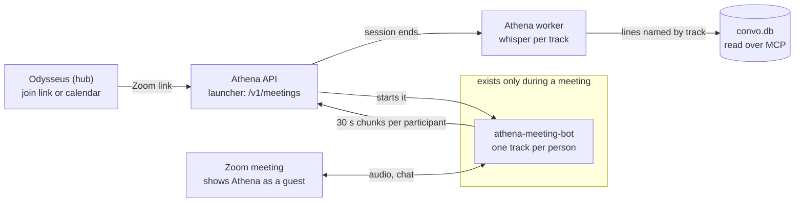
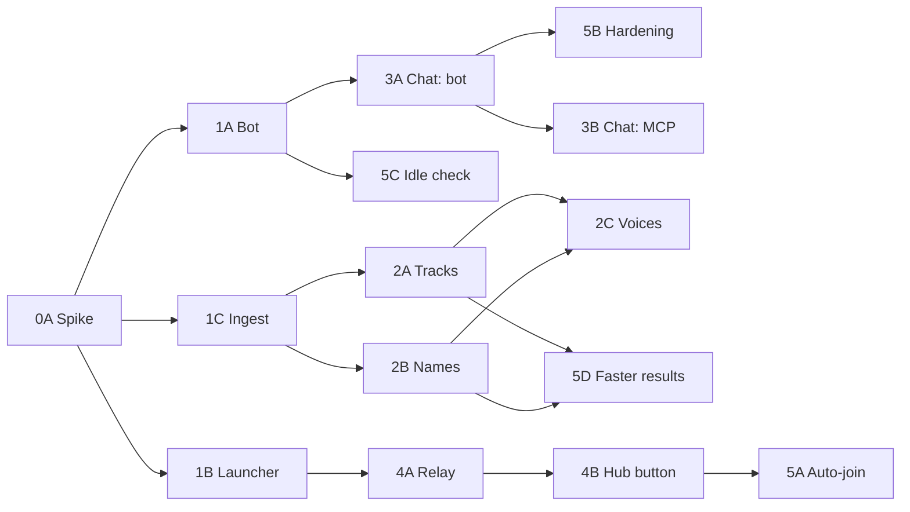

# Athena Zoom bot: phased plan

As of 2026-10-27. Status: plan, nothing built yet. Each lane below is sized for one Claude
subagent, one branch and one PR.

## Goal and priorities

Build a Zoom bot that joins a meeting as **Athena**. It records what each person says under
their Zoom name, plus the meeting chat, and hands it to Athena's existing pipeline.

Priorities, in order:

1. **It works well and is easy to use.** Right names on every line, even when people talk
   over each other; the chat and participant list kept; one paste in Odysseus to send it.
2. **Nothing runs when no meeting is on.** Athena is idle more than 99% of the time, so the
   bot is not a service: it starts on request and exits after the meeting. If Phase 0 shows
   a cold start is too slow, a small standby process is allowed (≤ 50 MB RAM, no CPU while
   waiting), but the default is start on demand.
3. **Optimized where it costs no function.** During a meeting quality wins: the server's
   Ryzen 7 3700X (8 cores, 16 threads) has room, so the bot records each participant on
   their own track. Work that adds nothing is left out: no video, no screen share, no
   pyannote for meeting audio.

Hard rules that stay:

- **Privacy.** No third-party bot service (Recall.ai, MeetingBaaS, Otter) and no Zoom cloud
  transcripts. Audio goes Zoom → owner's server only; whisper transcribes locally.
- **No announcements.** The bot shows in the participant list as "Athena". It posts nothing
  in chat and takes no commands from participants; it leaves on its own (Phase 1 leave
  rules) or when the owner stops it from Odysseus.

Not in scope: Google Meet and Teams (Phase 5 leaves room for them), video, screen-share
capture.

## Resource rules

Idle cost is the hard limit; meeting cost is measured and kept sensible, not squeezed.

| State | CPU | Memory | Disk | How it is checked |
| --- | --- | --- | --- | --- |
| Idle (no meeting) | 0 new processes | 0 MB added | Bot + Zoom SDK files only | `ps`, `ss -tlnp` and `systemd-cgtop` show nothing new; a test asserts importing the API starts no thread or timer |
| In a meeting (bot) | Expected well under 1 core; safety cap 2 cores | Safety cap 2 GB | Up to ~0.25 MB per minute per speaking participant (Opus 32 kbps), deleted after transcription | Phase 0 reports `pidstat` and peak RSS over a 30-minute meeting; caps only stop a runaway bot |
| In a meeting (Athena) | Per-chunk VAD per track, as today | No change | No change | Existing tests |
| After the meeting | Whisper on each track's speech only; no pyannote except for shared-room tracks | No change | Audio deleted after success (`CONVO_KEEP_AUDIO`) | Pipeline test: a meeting of named tracks never loads pyannote |

Per-track transcription costs about the same whisper time as one mixed recording: only
speech is transcribed, and people mostly take turns, so the tracks together hold about as
much speech as the meeting did.

Rules:

- The bot runs at `nice 10`, so a meeting never slows the owner's other services.
- One bot at a time (`CONVO_MEETING_BOT_MAX=1`; the owner is never in two meetings at
  once). A request over the limit gets a clear "busy" answer.
- Every bot has a hard lifetime: `CONVO_MAX_SESSION_SECONDS` (4 h today) plus the leave
  rules. A stuck bot is killed by its scope's runtime limit, not by a watchdog process.
- `convo-server` imports no meeting code at startup; it is imported on the first join
  request.

## Approach: Zoom Meeting SDK, one track per participant

Use the Zoom Meeting SDK for Linux, run headless. It is the only option that gives each
participant's own audio with their name and the chat, and it has no idle cost.

| Option | Idle cost | Speaker names | Chat | Main risk |
| --- | --- | --- | --- | --- |
| **Meeting SDK bot (chosen)** | None (process exits) | Each participant's own audio, with user id and display name | Yes, SDK chat events | Zoom app setup and approval rules; SDK is a closed binary |
| Headless browser bot | None (process exits) | Only the page's active-speaker indicator; one mixed track | Scraped from the page | Breaks whenever Zoom changes its web page; much worse names in crosstalk |
| Zoom RTMS (Zoom streams to us) | A public HTTPS endpoint that must always listen | Per-participant streams | Depends on plan | Always-on public endpoint and a supported Zoom plan |

What the bot does with the SDK:

- Joins with video off and never subscribes to video or screen share: they add nothing to a
  transcript.
- Takes each participant's one-way raw audio from the SDK and encodes it to its own 16 kHz
  mono Opus track at 32 kbps (near-transparent for speech, small on disk). A switch sends
  WAV instead (`CONVO_MEETING_TRACK_CODEC=wav`) if Phase 0 finds Opus costs accuracy.
- Language: Phase 0 tries the SDK from C++ and through a Python binding (for example
  `py-zoom-meeting-sdk`; check its license). Pick the one that is more reliable and easier
  to maintain; both are light enough on the 3700X.

The Zoom SDK is proprietary. It is never committed: the owner downloads it from their Zoom
developer account, and the build points at that folder.

## Architecture

The bot is a short-lived child process that Athena starts on request. Nothing about it runs
between meetings.



Only the `exists only during a meeting` part is new at run time, and it is gone when the
meeting ends; the hub, API and worker are the services already running today.

**Parts (all in the Athena repo):**

- `meeting-bot/`: the bot (`athena-meeting-bot`). Arguments: meeting link or id + passcode,
  Athena session id, a short-lived upload token. It joins as "Athena", records, uploads and
  exits.
- `server/convo_server/meetings.py`: the launcher, imported lazily by the API. It checks the
  request, enforces the bot limit, starts the bot under safety caps, and tracks its state in
  SQLite (`meetings` table).
- New API routes on the existing ingest API: `POST /v1/meetings` (join),
  `GET /v1/meetings/{id}` (state), `DELETE /v1/meetings/{id}` (leave).
- Pipeline change: a meeting session holds one track per participant; each track is
  transcribed on its own and its lines carry that participant's name.

**How a meeting flows:**

1. The owner pastes a Zoom link in Odysseus (Phase 4), or a calendar event triggers it
   (Phase 5). Odysseus calls the relay route, which forwards to `POST /v1/meetings`.
2. The launcher starts the bot. With systemd: `systemd-run --user --scope -p CPUQuota=200%
   -p MemoryMax=2G -p RuntimeMaxSec=<max> nice -n 10 athena-meeting-bot …`. Without systemd
   (background or Docker runner): the same process with `nice` and `RLIMIT_AS`, inside the
   API container for Docker, so no Docker socket is needed.
3. The bot joins as **Athena**. The host admits it from the waiting room if there is one.
   Most meetings are hosted by someone else, and Zoom gives raw audio only to an app that
   is host, co-host or granted recording permission. So once in the meeting the bot sends
   Zoom's own recording request **once** (owner's decision); the host sees Zoom's prompt.
   State `waiting_permission` until the host or a co-host allows it, then `recording`.
   If nobody allows it, or the host declines, the bot keeps waiting (reason `denied` when
   declined) and never asks again or leaves over it; the host can still grant it later.
   A bot that is already host, co-host or allowed (e.g. the owner's own meetings with
   recording pre-allowed) goes straight to `recording`. Athena posts nothing in chat and
   never works around Zoom's recording controls.
4. Every 30 s it uploads one chunk per participant who was in the meeting during that time
   to `POST /v1/ingest/chunk` on loopback, as the watch and call recorder already do, with
   `device=zoom` and the new optional fields `track` (Zoom user id) and `track_name`
   (display name). A participant who joins late starts a new track.
5. Athena runs VAD per chunk as today, per track. The bot obeys `"stop": true` too.
6. The bot leaves when the meeting ends, when it has been the only participant for 60 s,
   when it is removed, on `DELETE`, at the max duration, or when the owner leaves (with the
   default on-behalf-of token Zoom drops the bot then). It never leaves because recording
   permission is missing or declined, or because someone asks it to in chat. It ends the session, uploads
   chat (Phase 3) and exits.
7. Athena's worker finalizes the session: whisper on each track's speech, lines named by
   track and merged in time order, summary, facts, as for any conversation. With Phase 5D,
   most of this already happened during the meeting.

**Why tracks:** each line comes from one person's own microphone, so the name is right even
when two people talk at once, and whisper hears one clean voice instead of a mix. No
diarization model is needed for normal participants.

## Contract and interface changes

All changes are additive, so they ship as MCP 0.16.0 (today 0.15.0) with no breaking change.
Each still needs the hub module doc updated and a bakeoff rerun, per the versioning rules in
AGENTS.md.

| Where | Change | Phase |
| --- | --- | --- |
| `POST /v1/ingest/chunk` | Optional form fields `track` (≤ 64 chars, `[A-Za-z0-9._:-]`) and `track_name` (≤ 200 chars). Without `track` a session works exactly as today. Idempotent per (session, track, sequence); sequences count per track. | 1 |
| `POST /v1/meetings` | New. JSON `{url}` or `{meeting_id, passcode}`, optional `title`. Returns `{id, state}`; states `starting`, `waiting_room`, `recording`, `ended`, `failed` (with `reason`). `waiting_permission` (reason `denied` once the host declines) sits between `waiting_room` and `recording`; `recording` may carry reason `no_audio` when Zoom delivers no audio. `409 busy` over the bot limit. | 1 |
| `GET` / `DELETE /v1/meetings/{id}` | New. State, and leave now. | 1 |
| `POST /v1/sessions/{id}/chat` | New, bot only. Chat lines `{at, from, zoom_user_id, text}`. | 3 |
| MCP results | Meeting conversations say `(Zoom meeting: <topic>)` and list participants; chat lines show as `<name> (chat): …`. Fact and action-item JSON rows gain `source: "meeting"` where it applies. | 3 |
| Relay routes (`ingest_relay.py`) | `POST /meetings`, `GET`/`DELETE /meetings/{id}` forwarded with the ingest token, like the upload routes. Plain HTTP routes, never MCP tools. | 4 |

New settings, all optional, read only when a join request arrives:

The names below use today's `CONVO_` prefix. If step 7 of `docs/athena-rename-plan.md` has
landed by the time a lane starts, use `ATHENA_` instead (and `ATHENA_*` for the deploy.sh
variable in Phase 1), following that plan's rules.

- `CONVO_MEETING_BOT_PATH`: the bot binary. Unset means meetings are off and
  `POST /v1/meetings` answers `501`.
- `CONVO_ZOOM_SDK_KEY`, `CONVO_ZOOM_SDK_SECRET`: the owner's Meeting SDK app credentials.
  The launcher signs the SDK join token locally.
- `CONVO_MEETING_BOT_MAX` (1), `CONVO_MEETING_BOT_CPU` (200%), `CONVO_MEETING_BOT_MEMORY`
  (2G), `CONVO_MEETING_ALONE_SECONDS` (60), `CONVO_MEETING_WAITING_ROOM_SECONDS` (600),
  `CONVO_MEETING_TRACK_CODEC` (`opus`).
- `CONVO_ZOOM_OWNER_NAMES`: the owner's Zoom display names, so their lines are marked as the
  owner.

## Phase 0: Zoom app and spike

Prove the SDK bot can join as Athena and deliver each participant's audio, names and chat.
Nothing is merged except a short findings doc; this phase decides how Phase 1 is built.

**Owner does (an agent can't):**

- [ ] Create a Zoom Marketplace app with the Meeting SDK enabled; keep the SDK key and
      secret in `server/.env` only.
- [ ] Download the Meeting SDK for Linux to a folder outside the repo.
- [ ] Check Zoom's current rules for SDK apps joining meetings **outside the owner's
      account**, the main use: whether the app must pass Marketplace review or be published,
      and whether the bot must join on behalf of a signed-in Zoom user who is in the meeting
      (Zoom has been tightening this). Start the review early; it can take weeks.
- [ ] Host a test meeting with 2–3 fictional participants (other devices) for the
      measurements below, and join one test meeting hosted from a **different** Zoom account
      to check the recording-permission prompt and any join restrictions.

**Agent does (lane 0A, `docs/meeting-bot-spike.md` + throwaway code on a branch):**

- [ ] Minimal bot, in C++ and through a Python binding: join by id + passcode, name
      "Athena", video off; write each participant's audio to its own file and log chat
      events; leave after N minutes.
- [ ] Docker build that takes the SDK folder as a build input and never copies it into git.
- [ ] Measure for a 30-minute meeting: CPU (`pidstat 5`), peak RSS, time from start to
      "in meeting".
- [ ] Transcribe the fixture tracks as Opus 32 kbps and as WAV with the server's whisper
      model; report the word error rate difference.
- [ ] Write down: does the SDK need a display, PulseAudio or other helpers in the process;
      SDK disk size; which binding to use and why.
- [ ] Write down for a meeting in another account: what the host sees when Athena joins;
      Zoom's prompt when the bot sends its one recording request, how long until audio
      arrives after Allow, what happens on Deny and on a later grant; and whether the join needs a token from the owner's Zoom account.

**Gate to Phase 1:** joins as "Athena" without a display server; each participant's audio
arrives with their name; chat events arrive. The measurements are reported, not a gate,
unless the bot needs more than 2 cores sustained. If start-to-joined is over 30 s, the
findings propose a small standby process within the idle limit in priority 2. If the SDK
needs a fake audio device, run PulseAudio inside the bot's own scope, started and stopped
with it, never as a system service.

## Phase 1: Athena joins and uploads

The owner can start a bot with one API call; it joins as Athena, uploads one track per
participant, and leaves on its own. Three lanes run in parallel once the `track` fields
below are agreed.

**Lane 1A, bot (`meeting-bot/`):**

- [ ] Join from a link or id + passcode as "Athena", video off; handle waiting room, wrong
      passcode, meeting not started (each ends with a clear `failed` reason).
- [ ] One track per participant: Opus 32 kbps (or WAV per setting), 30 s chunks, a sequence
      per track; a participant who leaves and rejoins keeps their track (same Zoom user id).
- [ ] Upload with retry and backoff; keep unsent chunks on disk until accepted, up to
      `CONVO_MAX_SESSION_SECONDS` of audio.
- [ ] Leave rules from the Architecture section; on SIGTERM, flush the last chunks, end the
      session and exit within 5 s.
- [ ] Host tests for the track chunker with recorded PCM fixtures (no SDK needed in CI).

**Lane 1B, launcher (`server/convo_server/meetings.py`, `api.py`):**

- [x] `POST`/`GET`/`DELETE /v1/meetings`, behind the bearer token; `meetings` table; bot
      limit; `501` when `CONVO_MEETING_BOT_PATH` is unset.
- [x] Start the bot under safety caps (`systemd-run --scope` when available, else `nice` +
      `RLIMIT_AS`); read its state from a status line it prints on stdout. No polling
      thread: state updates come from the bot's output and its exit.
- [x] Sign the Meeting SDK join token locally from the key and secret.
- [x] Zoom sign-in. Since 2026-03-02 Zoom requires a signed-in Zoom user to join meetings
      in other accounts. **Default (owner's decision): an on-behalf-of (OBF) token from the
      owner's own Zoom account.** A one-time OAuth sign-in stores the refresh token in the
      data dir on the server; each join fetches a fresh OBF token for that meeting. Zoom only
      lets the bot in once the owner is in the meeting (the bot waits and retries, state
      `starting` with reason `waiting_for_owner`) and drops it when the owner leaves (`ended`
      with reason `owner_left`). Later option, for meetings the owner skips: a ZAK from a
      dedicated Athena Zoom account (`CONVO_ZOOM_JOIN_TOKEN=zak`), once Phase 0 Test C shows
      Zoom accepts it. Tokens are fetched only on a join request; nothing refreshes in the
      background.
- [x] Tests with a fake bot script; a test that importing `convo_server.api` starts no
      thread and imports nothing from `meetings.py`.

**Lane 1C, ingest (`api.py`, `pipeline.py`, `store.py`):**

- [x] Accept and validate `track` and `track_name`; store chunks per track; reassemble each
      track by its own sequence; idempotent per (session, track, sequence).
- [x] Tests: no `track` behaves exactly as today; two tracks with overlapping times are
      kept apart; a retried chunk is a no-op.

**Deploy (`server/scripts/deploy.sh`):** build the bot only when
`BARVIS_SOUND_ZOOM_SDK_DIR` is set; no new service or unit is installed.

**Done when:** in a real meeting the bot shows as "Athena", the session appears in Athena
with `device=zoom` and one track per participant, and nothing is left running after the
meeting. Server verification lists the commands and the meeting test.

## Phase 2: Names from Zoom tracks

Each line carries the name of the participant whose track it came from, and the server
skips pyannote for normal participants. Depends on Phase 1C.

**Lane 2A, per-track transcription (`pipeline.py`, new `meeting_tracks.py`):**

- [x] Transcribe each track's VAD speech on its own; every line from a track gets that
      track's participant; merge all lines in time order.
- [x] Crosstalk: lines from different tracks may overlap in time and are all kept, ordered
      by start time.
- [x] Bleed: when two participants share a room, one voice can reach both mics. Drop a line
      whose text nearly matches a line on another track at the same time, keeping the
      louder track's line.
- [x] A track whose display name is a room or device ("Conference Room", "iPhone", "Zoom
      user") can hold several people: pyannote runs on that track only.
- [x] Owner: names in `CONVO_ZOOM_OWNER_NAMES` become the owner (`is_owner=true`).
- [x] Test asserts a meeting of named tracks never loads or runs pyannote.

**Lane 2B, names to people (`speakers.py`, `people` table):**

- [x] Clean display names (drop "(he/him)", "| Company", device suffixes); match against
      people names and aliases; an unknown name becomes a new named speaker.
- [x] Key participants by Zoom user id, so one person who renames mid-meeting stays one
      person.
- [x] `rename_speaker_everywhere` keeps working; the Zoom display name is kept as an alias.

**Lane 2C, learning voices (on by default, owner's decision):**

- [ ] Take up to 3 windows of 3 s from each named participant's own track and save them as
      voice samples, so Athena recognizes them in later in-person recordings
      (`CONVO_LEARN_MEETING_VOICES`, default `true`; `false` turns it off).
- [ ] Skip shared-room tracks (several voices) and tracks with under 10 s of speech; replace
      a person's oldest meeting samples first so the set stays small.
- [ ] Voiceprints stay in `convo.db` on the server, like enrolled voices today.

**Done when:** the sandbox stack, fed a fictional 3-person meeting fixture with crosstalk
(`seed_demo.py` extended), names every line right and never loads pyannote; the bakeoff
score is no lower than today's sandbox score.

## Phase 3: Chat, participants and meeting title

The meeting's chat, its participant list and its Zoom topic land in the same conversation,
so summaries, facts and search use them. Depends on Phase 1; can run beside Phase 2.

**Lane 3A, bot:**

- [ ] Write chat messages to a small file in the bot's temp folder as they arrive (cap
      2,000 messages, 1 MB), and send them in one call to `POST /v1/sessions/{id}/chat`
      when the meeting ends, so a crash loses nothing.
- [ ] Send the meeting topic and the participant list (Zoom user id, display name, join and
      leave times) with the session end.
- [ ] Private messages sent to Athena are not stored, and Athena never replies.

**Lane 3B, server and MCP (`pipeline.py`, `mcp_server.py`):**

- [ ] Chat lines become transcript lines with `kind=chat`, at their real time, from their
      sender's person; they skip whisper and VAD.
- [ ] Summary prompt gets chat lines marked as chat; links and file names in chat are kept
      as text.
- [ ] MCP output as in the Contract section; MCP 0.16.0; update `server/README.md` JSON
      fields.
- [ ] Bakeoff: add 2 meeting questions with fictional data ("what did Dana post in chat?",
      "who was in the budget meeting?"); run `server/eval/bakeoff.py --frontend odysseus`
      in the sandbox and put the score in the PR.

**Done when:** a fictional meeting fixture with chat answers both new bakeoff questions in
the sandbox, and the hub PR for the module doc is linked.

## Phase 4: "Send Athena to a meeting" in Odysseus

The owner pastes a Zoom link on the Record a call page and Athena joins. Module side first
(Athena repo), then the hub PR (`SDarioosh/odysseus-expanded`), linked both ways. Depends on
Phase 1B.

**Lane 4A, Athena relay (`server/convo_server/ingest_relay.py`):**

- [x] Forward `POST /meetings`, `GET`/`DELETE /meetings/{id}` to the ingest API with
      `CONVO_INGEST_TOKEN`, behind `BearerAuth`. Not MCP tools.
- [x] Tests next to the existing relay tests.

**Lane 4B, hub (fork code in new files, hooks listed in `FORK.md`):**

- [ ] `src/meeting_bot.py`: calls the relay routes through the `convo` MCP server's URL and
      token, like `src/call_recorder.py`.
- [ ] On `static/call-recorder.html`: a "Send Athena to a meeting" box (link field, Join,
      Leave, state text: waiting room, recording, ended, or why it failed). State is
      fetched while the page is open; nothing polls when it is closed.
- [ ] Accept Zoom meeting links as pasted from an invite (including vanity subdomains and
      `zoommtg://` links); reject anything else before calling the module.
- [ ] Update `docs/fork/modules/odysseus-sound.md` and `FORK.md`.
- [ ] Tests: `tests/test_meeting_bot.py`; `node --check` on changed JS.

**Done when:** from the test instance on `127.0.0.1:7010`, a pasted link starts the bot and
Leave makes it exit; Server verification lists the steps. Production is changed only by the
owner with `scripts/fork_deploy.sh deploy` after merge.

## Phase 5: Calendar auto-join, hardening, faster results

Athena joins opted-in calendar meetings by itself, survives network drops, and has the
summary ready soon after the meeting. Nothing new runs in the background between meetings.

**Lane 5A, hub auto-join (`src/meeting_auto_join.py`, hook in the calendar sync):**

- [ ] When the existing calendar sync (`src/caldav_sync.py`) sees an event with a Zoom link,
      it creates or updates one one-shot task in the existing `TaskScheduler`, due 1 minute
      before the start, that calls the join route. A moved or deleted event updates or
      cancels that task. No polling loop is added.
- [ ] Opt-in per event (owner's decision): a "Send Athena" toggle on each event with a
      Zoom link, off by default. Only toggled events get a task.
- [ ] Overlapping toggled meetings: the earlier one wins; the other gets a notification
      that Athena was busy.

**Lane 5B, bot hardening:**

- [ ] Rejoin after a network drop (up to 3 tries within 2 minutes), keeping the same session
      id and track sequences.
- [ ] Breakout rooms: stay in the main room; note in the session when most participants
      left for breakouts.
- [ ] Host ends the meeting for all, or removes Athena: end the session cleanly.

**Lane 5C, idle and cost check:**

- [ ] A script (`server/scripts/meeting_bot_cost.py`) that runs the bot against a recorded
      fixture, reports CPU and memory, and fails if any bot process, socket or temp file is
      left after it exits. CI runs the fixture path; the owner runs it once per release in a
      real meeting.

**Lane 5D, results ready sooner (optional):**

- [ ] Transcribe each track's chunks while the meeting runs, so only the last chunk and the
      summary are left when it ends. Uses the existing worker and whisper-server; no new
      process. Target: summary within 2 minutes of the meeting ending.

**Later, not planned here:** Google Meet and Teams. The upload format (`track` fields, chat
route) stays the same, so only a new bot is needed.

## Handing lanes to Claude subagents

Give each lane to one subagent, one branch and one PR. A lane starts when every lane it
depends on is merged.



Wave 2 is the widest: five subagents (2A, 2B, 3A, 4A, 5C) can work at once. The table says
which lanes need the owner.

| Lane | Repo | Depends on | Can run beside | Needs the owner |
| --- | --- | --- | --- | --- |
| 0A Spike | Athena | Owner's Phase 0 setup | — | Zoom app, SDK download, test meeting |
| 1A Bot | Athena | 0A gate | 1B, 1C | Real-meeting test |
| 1B Launcher | Athena | 0A gate | 1A, 1C | — |
| 1C Ingest tracks | Athena | 0A gate | 1A, 1B | — |
| 2A Per-track transcription | Athena | 1C | 2B, 3A | — |
| 2B Names to people | Athena | 1C | 2A, 3A | — |
| 2C Voice learning | Athena | 2A, 2B | 3B, 5D | — |
| 3A Chat in bot | Athena | 1A | 2A, 2B | Real-meeting test |
| 3B Chat in server and MCP | Athena + hub doc | 3A | 2C | Bakeoff on the server |
| 4A Relay routes | Athena | 1B | 2x, 3x | — |
| 4B Hub button | odysseus-expanded | 4A | 2x, 3x | Test instance check |
| 5A Auto-join | odysseus-expanded | 4B | 5B, 5C, 5D | — |
| 5B Hardening | Athena | 3A | 5A, 5C, 5D | Real-meeting test |
| 5C Idle and cost check | Athena | 1A | 5A, 5B | One real run |
| 5D Faster results | Athena | 2A, 2B | 2C, 5A, 5B | One real meeting |

Agree the `track` and `track_name` fields in the 1C PR first; 1A and 2A both code against
them.

**Prompt template for each subagent** (fill in the lane):

```markdown
You are working on lane <ID> of the Athena Zoom bot plan: docs/zoom-meeting-bot-plan.md.
Read AGENTS.md first and follow it. Read the plan's "Goal and priorities",
"Resource rules", "Architecture", "Contract" sections and your lane.

Scope: only the checklist of lane <ID>. Don't touch other lanes' files beyond
what the plan names. Branch: feature/meeting-bot-<id>. Open a draft PR into main.

Priorities: it works well and is easy to use first; nothing runs, listens or
polls when no meeting is on; then optimize where it costs no function. Show in
the PR that meeting code is imported only on a join request and that nothing
is left running after a meeting.

Use fictional data only. Run ruff and pytest in server/. Add a Server
verification section with exact commands for anything you can't run in the
sandbox (a real Zoom meeting). After three failed attempts at one problem,
stop and write ESCALATE: <reason>.
```

## Risks and owner decisions

| Risk | Effect | Fallback |
| --- | --- | --- |
| Zoom requires app review and a signed-in Zoom user for meetings in other accounts (the main use; enforced since 2026-03-02). Zoom's docs say the Meeting SDK "does not support bots or AI notetakers" and point to RTMS | Bot can't join most meetings until approved; Zoom may refuse a bot account's ZAK join | Submit for review in Phase 0. Default: on-behalf-of the owner (owner's decision; the owner must be in the meeting). Later: Athena's own Zoom account's ZAK for meetings the owner skips, if Phase 0 Test C shows Zoom accepts it. Last resort: RTMS, which needs an always-listening public endpoint and so breaks priority 2; the owner decides |
| SDK needs a display, PulseAudio or other helpers | More to start per meeting | Start them inside the bot's scope only, so idle cost stays zero |
| Cold start is slow (over 30 s to join) | Joins late | A small standby process within the idle limit (≤ 50 MB, no CPU while waiting), decided in Phase 0 |
| Zoom SDK updates force a rebuild | Bot stops joining until updated | `GET /v1/meetings` reports the SDK error; deploy.sh rebuilds when the SDK folder changes |
| Zoom delivers no raw audio unless the bot is host, co-host or granted recording permission (Zoom's rule) | No audio until the host allows it | The bot sends Zoom's recording request once and waits in `waiting_permission`; the hub shows "waiting for the host to allow recording". The host (or the owner, if made co-host) clicks Allow. Athena does not work around Zoom's recording controls |
| Shared room microphone | Several people on one track | Phase 2 runs pyannote on that track only |
| Two participants in one room | Same words on two tracks | Phase 2 drops the duplicate line, keeping the louder track |

**Owner decisions (2026-10-27):**

- The bot is mainly for **other people's meetings**, not just the owner's. Phase 0 checks
  Zoom's rules for that first, and the owner registers the Zoom app.
- **Store voiceprints** of meeting participants: lane 2C is on by default.
- **Auto-join per event**: a toggle on each calendar event, no blanket rule.
- **One bot at a time**: the owner is never in two meetings at once.
