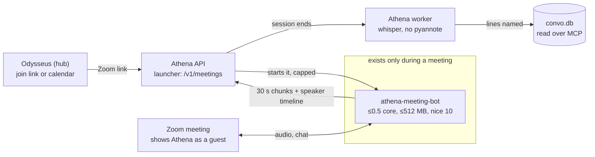
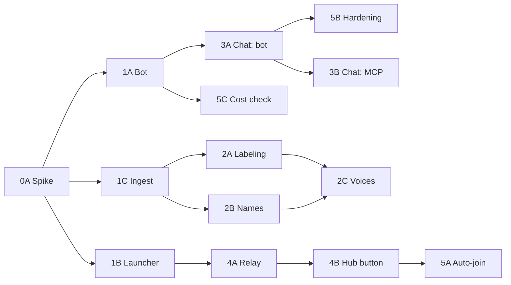

# Athena Zoom bot: phased plan

As of 2026-10-27. Status: plan, nothing built yet. Each lane below is sized for one Claude
subagent, one branch and one PR.

## Goal and hard constraints

Build a Zoom bot that joins a meeting as **Athena**. It records what each person says under
their Zoom name, plus the meeting chat, and hands it to Athena's existing pipeline. The bot
runs on the owner's server and costs nothing while no meeting is on.

Athena is idle more than 99% of the time, so resource use drives every decision below, ahead
of features:

1. **Zero idle cost.** No new always-on process, container, poller or open socket. The bot
   exists only while it is in a meeting, then exits.
2. **Low active cost.** Audio only: the bot never receives, decodes or renders video. It runs
   under hard CPU and memory caps the OS enforces.
3. **Less work for Athena, not more.** Zoom's speaker labels replace pyannote diarization for
   meeting audio. pyannote runs over the whole recording, so skipping it makes a Zoom meeting
   cost the server less than the same call recorded today.
4. **Privacy rules still hold.** No third-party bot service (Recall.ai, MeetingBaaS, Otter)
   and no Zoom cloud transcripts. Audio goes Zoom → owner's server only; whisper transcribes
   locally.
5. **Clear name, no announcements.** The bot shows in the participant list as "Athena". It
   posts nothing in chat and takes no commands from participants; it leaves on its own
   (Phase 1 leave rules) or when the owner stops it from Odysseus.

Not in scope: Google Meet and Teams (Phase 5 leaves room for them), video, screen-share
capture, live captions during the meeting.

## Resource budget

Every phase must stay inside these limits and prove it in its PR. The active numbers are
targets; Phase 0 measures the real ones and this table is updated with them before Phase 1
starts.

| State | CPU | Memory | Disk | Network | How it is checked |
| --- | --- | --- | --- | --- | --- |
| Idle (no meeting) | 0 new processes | 0 MB added | Bot binary + Zoom SDK only (Phase 0 measures, target < 400 MB) | No sockets, no polling | `ps`, `ss -tlnp` and `systemd-cgtop` show nothing new; test asserts no thread or timer is started at import |
| In a meeting (bot) | ≤ 0.25 core average, hard cap 0.5 core | ≤ 300 MB, hard cap 512 MB | ≤ 2 MB per minute of chunks, deleted after transcription | Audio only, no video subscriptions | `systemd-run` scope (or cgroup) caps; Phase 0 reports `pidstat` and peak RSS over a 30-minute test meeting |
| In a meeting (Athena) | Per-chunk VAD only, as today | No change | No change | Loopback uploads | Existing tests; no new worker thread |
| After the meeting | Whisper on speech regions only; no pyannote diarization for labeled meetings | No change | Audio deleted after success (`CONVO_KEEP_AUDIO`) | None | Pipeline test: meeting session never loads or runs pyannote |

Rules that keep it there:

- The bot runs at `nice 10`, so a meeting never slows the owner's other services.
- At most one bot at a time by default (`CONVO_MEETING_BOT_MAX=1`); a second join request
  gets a clear "busy" answer.
- Every bot has a hard lifetime: `CONVO_MAX_SESSION_SECONDS` (4 h today) plus leave rules in
  Phase 1. A stuck bot is killed by its scope's runtime limit, not by a watchdog process.
- No new dependency is imported by `convo-server` at startup. Meeting code is imported only
  when a join request arrives.

## Approach: Zoom Meeting SDK, audio only

Use the Zoom Meeting SDK for Linux, run headless and audio-only. It is the cheapest of the
three options and the only one that gives each participant's audio with their name. Cost
figures here are estimates from how each option works; Phase 0 measures the chosen one.

| Option | Idle cost | Cost in a meeting (estimate) | Speaker names | Chat | Main risk |
| --- | --- | --- | --- | --- | --- |
| **Meeting SDK bot (chosen)** | None (process exits) | Low: a native process decoding audio only | Per-participant audio tagged with user id and display name | Yes, SDK chat events | Zoom app setup and approval rules; SDK is a closed binary |
| Headless browser bot | None (process exits) | High: a full Chromium plus the Zoom web client, typically over 1 core and 1 GB | Only from the page's active-speaker indicator | Scraped from the page | Breaks whenever Zoom changes its web page |
| Zoom RTMS (Zoom streams to us) | A public HTTPS endpoint that must always listen | Low | Per-participant streams | Depends on plan | Needs an always-on public endpoint and a supported Zoom plan, which breaks the zero-idle rule |

How the SDK bot stays cheap:

- Join with video off and never subscribe to any video stream or screen share.
- Use the SDK's raw-audio callbacks: one mixed stream for the recording, plus per-participant
  frames used only to measure who is talking (an energy level per 20 ms frame). No extra
  decoding or model runs in the bot.
- Encode the mixed stream to 16 kHz mono Opus, the format Athena already takes, so Athena
  does no extra conversion.
- Write the audio hot path in C++ against the SDK directly. A Python wrapper is allowed only
  if Phase 0 shows it stays under the CPU budget.

The Zoom SDK is proprietary. It is never committed: the owner downloads it from their Zoom
developer account, and the build points at that folder.

## Architecture

The bot is a short-lived child process that Athena starts on request. It is not a service.
Nothing about it runs between meetings.



Only the `exists only during a meeting` part is new at run time, and it is gone when the
meeting ends; the hub, API and worker are the services already running today.

**Parts (all in the Athena repo):**

- `meeting-bot/`: the C++ bot (`athena-meeting-bot`). Arguments: meeting link or id +
  passcode, Athena session id, a short-lived upload token. It joins as "Athena", records,
  uploads and exits.
- `server/convo_server/meetings.py`: the launcher, imported lazily by the API. It checks the
  request, enforces the one-bot limit, starts the bot under resource caps, and tracks its
  state in SQLite (`meetings` table).
- New API routes on the existing ingest API: `POST /v1/meetings` (join),
  `GET /v1/meetings/{id}` (state), `DELETE /v1/meetings/{id}` (leave).
- Pipeline change: sessions with a speaker timeline are labeled from it instead of pyannote
  diarization.

**How a meeting flows:**

1. The owner pastes a Zoom link in Odysseus (Phase 4), or a calendar event triggers it
   (Phase 5). Odysseus calls the relay route, which forwards to `POST /v1/meetings`.
2. The launcher starts the bot. With systemd: `systemd-run --user --scope -p CPUQuota=50%
   -p MemoryMax=512M -p RuntimeMaxSec=<max> nice -n 10 athena-meeting-bot …`. Without
   systemd (background or Docker runner): the same process with `nice` and `RLIMIT_AS`,
   inside the API container for Docker, so no Docker socket is needed.
3. The bot joins as **Athena**. The host admits it from the waiting room if there is one.
4. Every 30 s it uploads a chunk to `POST /v1/ingest/chunk` on loopback, as the watch and
   call recorder already do, with `device=zoom` and the new optional `speaker_timeline`
   field: who spoke when in that chunk, by Zoom user id and name.
5. Athena runs VAD per chunk as today. The bot obeys `"stop": true` too.
6. The bot leaves when the meeting ends, when it has been the only participant for 60 s,
   when it is removed, on `DELETE`, or at the max duration. It ends the session, uploads
   chat (Phase 3) and exits. Its memory and CPU return to zero.
7. Athena's worker finalizes the session: whisper on speech regions, lines labeled from the
   timeline, summary, facts, as for any conversation.

**Why the timeline is enough:** the bot already has each person's audio, so it only needs a
20 ms energy check per person to mark who is speaking. Athena transcribes the mixed audio
once, then gives each line the name of whoever spoke most during it. Transcribing each
person separately would multiply whisper's work, so it is not done.

## Contract and interface changes

All changes are additive, so they ship as MCP 0.16.0 (today 0.15.0) with no breaking change.
Each still needs the hub module doc updated and a bakeoff rerun, per the versioning rules in
AGENTS.md.

| Where | Change | Phase |
| --- | --- | --- |
| `POST /v1/ingest/chunk` | Optional form field `speaker_timeline`: JSON list of `{start, end, zoom_user_id, name}`, times in seconds from chunk start. Ignored by older callers. Same idempotency per (session, sequence). | 1 |
| `POST /v1/meetings` | New. JSON `{url}` or `{meeting_id, passcode}`, optional `title`. Returns `{id, state}`; states `starting`, `waiting_room`, `recording`, `ended`, `failed` (with `reason`). `409 busy` when a bot is already running. | 1 |
| `GET` / `DELETE /v1/meetings/{id}` | New. State, and leave now. | 1 |
| `POST /v1/sessions/{id}/chat` | New, bot only. Chat lines `{at, from, zoom_user_id, text}`. | 3 |
| MCP results | Meeting conversations say `(Zoom meeting: <topic>)` and list participants; chat lines show as `<name> (chat): …`. Fact and action-item JSON rows gain `source: "meeting"` where it applies. | 3 |
| Relay routes (`ingest_relay.py`) | `POST /meetings`, `GET`/`DELETE /meetings/{id}` forwarded with the ingest token, like the upload routes. Plain HTTP routes, never MCP tools. | 4 |

New settings, all optional, read only when a join request arrives:

The names below use today's `CONVO_` prefix. If step 7 of `docs/athena-rename-plan.md` has
landed by the time a lane starts, use `ATHENA_` instead (and `ATHENA_*` for the deploy.sh
variable in Phase 1), following that plan's rules.


- `CONVO_MEETING_BOT_PATH`: the bot binary. Unset means meetings are off and
  `POST /v1/meetings` answers `501`.
- `CONVO_ZOOM_SDK_KEY`, `CONVO_ZOOM_SDK_SECRET`: the owner's Meeting SDK app credentials.
  The launcher signs the SDK join token locally.
- `CONVO_MEETING_BOT_MAX` (1), `CONVO_MEETING_BOT_CPU` (50%), `CONVO_MEETING_BOT_MEMORY`
  (512M), `CONVO_MEETING_ALONE_SECONDS` (60), `CONVO_MEETING_WAITING_ROOM_SECONDS` (600).
- `CONVO_ZOOM_OWNER_NAMES`: the owner's Zoom display names, so their lines are marked as the
  owner.

## Phase 0: Zoom app and cost spike

Prove the SDK bot can join as Athena, get per-person audio, and stay inside the budget.
Nothing is merged except a short findings doc; this phase decides whether the plan goes
ahead as written.

**Owner does (an agent can't):**

- [ ] Create a Zoom Marketplace app with the Meeting SDK enabled; keep the SDK key and
      secret in `server/.env` only.
- [ ] Download the Meeting SDK for Linux to a folder outside the repo.
- [ ] Check Zoom's current rules for SDK apps joining meetings outside the owner's account
      (review or publishing may be needed), and whether raw audio needs the host's recording
      permission or a local-recording join token.
- [ ] Host a test meeting with 2–3 fictional participants (other devices) for the
      measurements below.

**Agent does (lane 0A, `docs/meeting-bot-spike.md` + throwaway code on a branch):**

- [ ] Minimal C++ program: join by id + passcode, name "Athena", video off, audio raw-data
      on; write the mixed PCM and per-user energy to files; leave after N minutes.
- [ ] Docker build that takes the SDK folder as a build input and never copies it into git.
- [ ] Script that records CPU (`pidstat 5`), peak RSS and network for a 30-minute meeting.
- [ ] Write down: does the SDK need a display, PulseAudio or other daemons in the process
      (each costs memory); SDK disk size; join time.

**Gate to Phase 1:** joins as "Athena" without a display server, separate audio per
participant arrives with names, and the 30-minute test shows ≤ 0.25 core average and
≤ 300 MB peak. If the SDK needs a fake audio device, run PulseAudio inside the bot's own
scope, started and stopped with it, never as a system service. If the budget is missed by
more than 2×, stop and decide with the owner before more work (see Risks).

## Phase 1: Athena joins and uploads

The owner can start a bot with one API call; it joins as Athena, uploads 30 s chunks with a
speaker timeline, and leaves on its own. Three lanes run in parallel once the timeline format
below is agreed.

**Lane 1A, bot (`meeting-bot/`):**

- [ ] Join from a link or id + passcode as "Athena", video off; handle waiting room, wrong
      passcode, meeting not started (each ends with a clear `failed` reason).
- [ ] Mix to 16 kHz mono, encode Opus with libopus, cut 30 s Ogg chunks; upload with retry
      and backoff; keep at most 3 unsent chunks on disk.
- [ ] Per participant, mark speaking when the frame's energy is over a threshold for
      ≥ 200 ms; merge gaps < 300 ms; emit the chunk's `speaker_timeline`.
- [ ] Leave rules from the Architecture section; on SIGTERM, flush the last chunk, end the
      session and exit within 5 s.
- [ ] Host tests for the timeline builder and chunker with recorded PCM fixtures (no SDK
      needed in CI).

**Lane 1B, launcher (`server/convo_server/meetings.py`, `api.py`):**

- [ ] `POST`/`GET`/`DELETE /v1/meetings`, behind the bearer token; `meetings` table;
      one-bot limit; `501` when `CONVO_MEETING_BOT_PATH` is unset.
- [ ] Start the bot under caps (`systemd-run --scope` when available, else `nice` +
      `RLIMIT_AS`); read its state from a status line it prints on stdout. No polling
      thread: state updates come from the bot's output and its exit.
- [ ] Sign the Meeting SDK join token locally from the key and secret.
- [ ] Tests with a fake bot script; a test that importing `convo_server.api` starts no
      thread and imports nothing from `meetings.py`.

**Lane 1C, ingest (`api.py`, `pipeline.py`, `store.py`):**

- [ ] Accept and validate `speaker_timeline` (bounded size, times inside the chunk); store
      it per chunk; idempotent on retry.
- [ ] Tests: missing field behaves exactly as today; malformed field rejected with 422.

**Deploy (`server/scripts/deploy.sh`):** build the bot only when
`BARVIS_SOUND_ZOOM_SDK_DIR` is set; no new service or unit is installed.

**Done when:** in a real meeting the bot shows as "Athena", the session appears in Athena
with `device=zoom`, and the Phase 0 cost numbers still hold. Server verification lists the
commands and the meeting test.

## Phase 2: Names from Zoom instead of pyannote

Meeting lines carry the speaker's Zoom name, and the server skips pyannote diarization for
them, so a Zoom meeting is cheaper to process than a recorded call. Depends on Phase 1C.

**Lane 2A, labeling (`pipeline.py`, new `meeting_speakers.py`):**

- [ ] For each transcript line, give it the participant who was speaking for most of the
      line's time. A line nobody overlaps stays unnamed ("Speaker 1"). pyannote runs on the
      whole recording, as today, only when more than 20% of the speech has no timeline.
- [ ] Overlapping speech: the participant with the most speaking time wins; a tie keeps the
      line unlabeled.
- [ ] A participant whose display name is a room or device ("Conference Room", "iPhone",
      "Zoom user") counts as several possible people: pyannote runs only on the stretches
      where that participant spoke.
- [ ] Owner: names in `CONVO_ZOOM_OWNER_NAMES` become the owner (`is_owner=true`).
- [ ] Test asserts a fully labeled meeting never loads or runs pyannote.

**Lane 2B, names to people (`speakers.py`, `people` table):**

- [ ] Clean display names (drop "(he/him)", "| Company", device suffixes); match against
      people names and aliases; an unknown name becomes a new named speaker.
- [ ] Store the Zoom user id per meeting so one person who renames mid-meeting stays one
      person.
- [ ] `rename_speaker_everywhere` keeps working; the Zoom display name is kept as an alias.

**Lane 2C, learning voices (optional, off by default):**

- [ ] When `CONVO_LEARN_MEETING_VOICES=true`, take at most 3 windows of 3 s per named
      participant, only where they spoke alone, and save them as voice samples. That is at
      most 3 embeddings per person per meeting, so the cost stays small.
- [ ] Off by default because it stores other people's voiceprints; the owner decides
      (Risks).

**Done when:** the sandbox stack, fed a fictional 3-person meeting fixture (`seed_demo.py`
extended), shows every line named and pyannote never loaded; the bakeoff score is no lower
than today's sandbox score.

## Phase 3: Chat, participants and meeting title

The meeting's chat, its participant list and its Zoom topic land in the same conversation,
so summaries, facts and search use them. Depends on Phase 1; can run beside Phase 2.

**Lane 3A, bot:**

- [ ] Keep chat messages in memory (cap 2,000 messages, 1 MB) and send them in one call to
      `POST /v1/sessions/{id}/chat` when the meeting ends. No per-message uploads.
- [ ] Send the meeting topic and the participant list (Zoom user id, display name, join and
      leave times) with the session end.
- [ ] Private messages sent to Athena are not stored, and Athena never replies.

**Lane 3B, server and MCP (`pipeline.py`, `mcp_server.py`):**

- [ ] Chat lines become transcript lines with `kind=chat`, at their real time, from their
      sender's person; they skip whisper and VAD.
- [ ] Summary prompt gets chat lines marked as chat; links and file names in chat are kept
      as text.
- [ ] MCP output as in the Contract section; MCP 0.16.0; update `server/README.md` JSON
      fields.
- [ ] Bakeoff: add 2 meeting questions with fictional data ("what did Dana post in chat?",
      "who was in the budget meeting?"); run `server/eval/bakeoff.py --frontend odysseus`
      in the sandbox and put the score in the PR.

**Done when:** a fictional meeting fixture with chat answers both new bakeoff questions in
the sandbox, and the hub PR for the module doc is linked.

## Phase 4: "Send Athena to a meeting" in Odysseus

The owner pastes a Zoom link on the Record a call page and Athena joins. Module side first
(Athena repo), then the hub PR (`SDarioosh/odysseus-expanded`), linked both ways. Depends on
Phase 1B.

**Lane 4A, Athena relay (`server/convo_server/ingest_relay.py`):**

- [ ] Forward `POST /meetings`, `GET`/`DELETE /meetings/{id}` to the ingest API with
      `CONVO_INGEST_TOKEN`, behind `BearerAuth`. Not MCP tools.
- [ ] Tests next to the existing relay tests.

**Lane 4B, hub (fork code in new files, hooks listed in `FORK.md`):**

- [ ] `src/meeting_bot.py`: calls the relay routes through the `convo` MCP server's URL and
      token, like `src/call_recorder.py`.
- [ ] On `static/call-recorder.html`: a "Send Athena to a meeting" box (link field, Join,
      Leave, state text). State is fetched when the page is open and when Join or Leave is
      pressed. No background polling in the hub when the page is closed.
- [ ] Accept only `zoom.us` meeting links (and Zoom's vanity subdomains); reject anything
      else before calling the module.
- [ ] Update `docs/fork/modules/odysseus-sound.md` and `FORK.md`.
- [ ] Tests: `tests/test_meeting_bot.py`; `node --check` on changed JS.

**Done when:** from the test instance on `127.0.0.1:7010`, a pasted link starts the bot and
Leave makes it exit; Server verification lists the steps. Production is changed only by the
owner with `scripts/fork_deploy.sh deploy` after merge.

## Phase 5: Calendar auto-join and hardening

Athena joins opted-in calendar meetings by itself, using the hub's existing calendar sync
and task scheduler; nothing new runs in the background. Depends on Phase 4.

**Lane 5A, hub auto-join (`src/meeting_auto_join.py`, hook in the calendar sync):**

- [ ] When the existing calendar sync (`src/caldav_sync.py`) sees an event with a Zoom link,
      it creates or updates one one-shot task in the existing `TaskScheduler`, due 1 minute
      before the start, that calls the join route. A moved or deleted event updates or
      cancels that task. No polling loop is added.
- [ ] Opt-in: off by default; per event (a "Send Athena" toggle on the event) or a rule
      ("all events with a Zoom link").
- [ ] Two overlapping meetings: the one that starts first wins; the other gets a
      notification that Athena was busy.

**Lane 5B, bot hardening:**

- [ ] Rejoin once after a network drop within 60 s, keeping the same session id and
      sequence.
- [ ] Breakout rooms: stay in the main room; note in the session when most participants
      left for breakouts.
- [ ] Host ends the meeting for all, or removes Athena: end the session cleanly.
- [ ] Write chat to a small file in the bot's temp folder as it arrives, so a crash doesn't
      lose it (bounded by the Phase 3 caps).

**Lane 5C, cost regression check:**

- [ ] A script (`server/scripts/meeting_bot_cost.py`) that runs the bot against a recorded
      fixture and fails if CPU or memory pass the budget. CI runs it on the fixture-only
      path; the owner runs it once per release in a real meeting.

**Later, not planned here:** Google Meet and Teams. The upload format (`speaker_timeline`,
chat route) stays the same, so only a new bot is needed.

## Handing lanes to Claude subagents

Give each lane to one subagent, one branch and one PR. A lane starts when every lane it
depends on is merged.



Wave 2 is the widest: five subagents (2A, 2B, 3A, 4A, 5C) can work at once. The table says
which lanes need the owner.

| Lane | Repo | Depends on | Can run beside | Needs the owner |
| --- | --- | --- | --- | --- |
| 0A Spike | Athena | Owner's Phase 0 setup | — | Zoom app, SDK download, test meeting |
| 1A Bot | Athena | 0A gate | 1B, 1C | Real-meeting test |
| 1B Launcher | Athena | 0A gate | 1A, 1C | — |
| 1C Ingest field | Athena | 0A gate | 1A, 1B | — |
| 2A Labeling | Athena | 1C | 2B, 3A | — |
| 2B Names to people | Athena | 1C | 2A, 3A | — |
| 2C Voice learning | Athena | 2A, 2B | 3B | Decide on voiceprints |
| 3A Chat in bot | Athena | 1A | 2A, 2B | Real-meeting test |
| 3B Chat in server and MCP | Athena + hub doc | 3A | 2C | Bakeoff on the server |
| 4A Relay routes | Athena | 1B | 2x, 3x | — |
| 4B Hub button | odysseus-expanded | 4A | 2x, 3x | Test instance check |
| 5A Auto-join | odysseus-expanded | 4B | 5B, 5C | Opt-in rule |
| 5B Hardening | Athena | 3A | 5A, 5C | Real-meeting test |
| 5C Cost check | Athena | 1A | 5A, 5B | One real run |

Agree the `speaker_timeline` JSON shape in the 1C PR first; 1A and 2A both code against it.

**Prompt template for each subagent** (fill in the lane):

```markdown
You are working on lane <ID> of the Athena Zoom bot plan: docs/zoom-meeting-bot-plan.md.
Read AGENTS.md first and follow it. Read the plan's "Goal and hard constraints",
"Resource budget", "Architecture", "Contract" sections and your lane.

Scope: only the checklist of lane <ID>. Don't touch other lanes' files beyond
what the plan names. Branch: feature/meeting-bot-<id>. Open a draft PR into main.

Resource rules you must prove in the PR:
- nothing new runs, listens or polls when no meeting is on;
- meeting code is imported only on a join request;
- the bot stays under its CPU and memory caps.

Use fictional data only. Run ruff and pytest in server/. Add a Server
verification section with exact commands for anything you can't run in the
sandbox (a real Zoom meeting). After three failed attempts at one problem,
stop and write ESCALATE: <reason>.
```

## Risks and open questions

| Risk | Effect | Fallback |
| --- | --- | --- |
| Zoom requires app review before the bot can join meetings outside the owner's account | Bot works only in the owner's own meetings until approved | Start with own meetings; submit for review in parallel |
| SDK needs a display, PulseAudio or other helpers | Higher memory in a meeting | Start them inside the bot's scope only, so idle cost stays zero; re-measure against the budget |
| SDK cost over budget by more than 2× | Breaks the low-power goal | Lower the Opus bitrate, drop per-person energy to every 40 ms; last resort is the browser bot, which is far heavier and only worth it if the owner accepts the cost |
| Zoom SDK updates force a rebuild | Bot stops joining until updated | `GET /v1/meetings` reports the SDK error; deploy.sh rebuilds when the SDK folder changes |
| Host denies recording permission | No audio | Bot leaves with reason `recording_denied` and the hub shows it |
| Shared room microphone | Several people under one name | Phase 2 runs pyannote on that participant's stretches only |

**Open questions for the owner:**

- [ ] Will you register the Zoom Marketplace app, and is the bot only for meetings you host,
      or for others' meetings too?
- [ ] Should Athena store voiceprints of other meeting participants (Phase 2C), or only
      label them by Zoom name?
- [ ] Auto-join: per event, or every event with a Zoom link?
- [ ] Is one bot at a time enough, or do you need two overlapping meetings?
